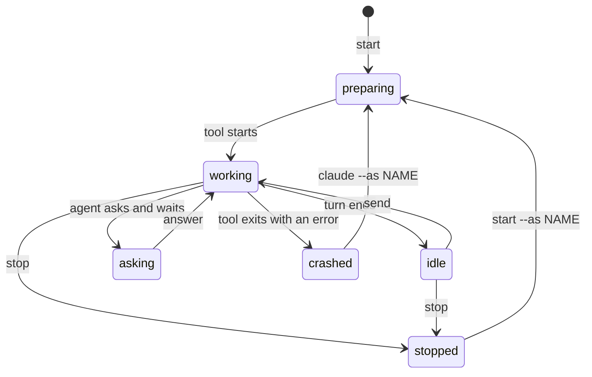
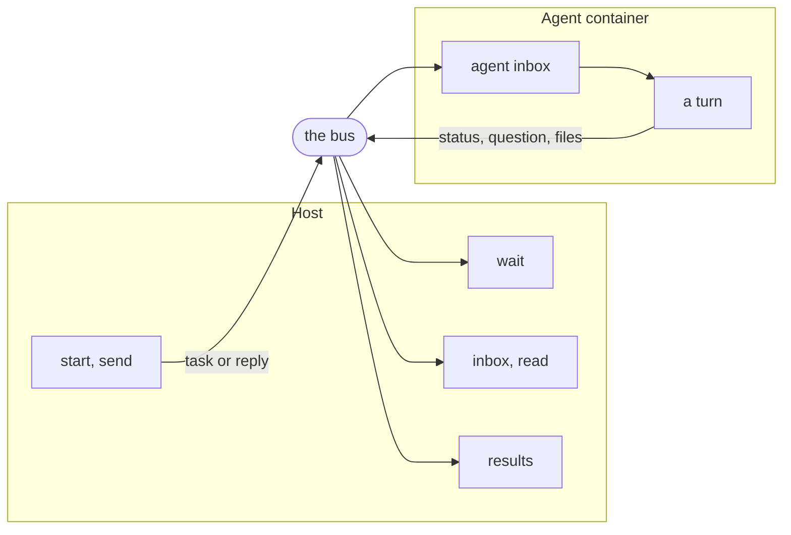

> Part of the Dockingbird customer docs. The index for agents is [llms.txt](../../llms.txt).

You hand a delegated agent a task, and it works in the background while you do something else. Everything between you and that agent travels on one message bus. This page follows a task from `start` to the saved results.

## What the bus is

Besides `dockingbird claude` and `dockingbird codex`, which you work in, Dockingbird runs agents that you give a task and then talk to by message. Each one has its own container and its own copy of the branch. Every exchange command acts as one client of yours on this computer, the host client. A question an agent asks you therefore waits in a single inbox, and every message you send names you as its sender, so the agent can answer you.

## How a message travels

`dockingbird start "Fix the failing test"` starts the agent and returns once it runs, in about half a minute. It prints `claude-1 started on myapp (main).` and then `Thread <id>. Watch: dockingbird wait claude-1`. The task is the first message of the agent's thread. Every later task you send continues that thread.

The agent works through a turn. After each turn it sends you a status message such as `turn 3` with its final text, at priority P3, the lowest. An error arrives at once at P1, so it sorts before every summary, task and question. You read what came back with `wait`, `inbox` and `read`, and you save the files with `results`.

| Command | What it moves |
|---|---|
| `start "TASK"` | Starts an agent and delivers the task as the first message of its thread. |
| `send NAME TEXT` | Delivers a message. It answers the agent's one open question, or it is a new task when none is open. |
| `send NAME --withdraw N` | Takes a message back. An agent that already accepted it is asked to stop that work. |
| `wait NAME` | Returns at once with a message you have not seen, or waits for the next one, 25 seconds by default. |
| `inbox` | Lists the messages waiting for you, each priority's newest first, 20 to a page. |
| `read N` | Shows one message whole and marks it read. `--keep` leaves it unread. |
| `results NAME` | Saves the files attached in the agent's task thread under `DOCKINGBIRD_HOME/results/NAME/`. |
| `inbox NAME` | Lists what other agents and you sent to that agent. Nothing is copied into your inbox. |

## Questions and deliveries

A delivery is one message in an inbox. A question row is one line of `dockingbird questions`: a question an agent asks you, with the number it got when you first saw it. The number stays until you answer. `dockingbird answer 3 --option 2` or `dockingbird answer 3 "Use Vue."` answers it.

A question can come from a choice the tool put up, a plan to approve, the end of a Codex turn at a terminal, or a message the agent sent you with kind `question`. A question stays open until you answer it. A message that an agent or you send with `--requires-ack` or `--reply-required` stays open until its target replies or acknowledges it, shows again on a reminder schedule, and tells its sender once at its deadline. [Reliable messages](../guides/reliable-messages.md) marks and expects them. An agent that asks and waits shows `asks` in `dockingbird status` and does not go on until you answer. An agent that asks without waiting keeps working, and its question stays listed. A question a stopped agent asked is withdrawn.

## Between agents

An agent sends to another agent of the project by name, with `to=<name>` in its `bus_send`. Dockingbird delivers the message to that inbox. One message can also go to a group: `all`, `role` or `swarm` in `bus_send`, and `--all`, `--role` and `--swarm` in `dockingbird send`. A name no agent has, or an agent that has ended, is refused with `AGENT_UNKNOWN` or `AGENT_ENDED`. An agent in a swarm role that names `send_to` can reach only its parent and the roles listed, and any other send is refused with `FORBIDDEN` and the reason `NOT_IN_SEND_RULES`.

Agents on the same repository and branch hear of each other. The first delivery names the others, and `Agent <name> joined your work` and `Agent <name> left your work` follow. You can read what they send each other with `dockingbird inbox claude-2`, and reading changes nothing for that agent.

## An agent that manages other agents

One agent can direct the others, for example a lead that hands out work and answers questions. What it reaches depends on where the other agents run.

| Where the other agent runs | How the managing agent reaches it |
|---|---|
| the same home | `bus_send` with `to=<name>`, for every live agent of the home, on any repository or in a scratch folder |
| another home on the same computer | no bus route; `bus_send` answers `AGENT_UNKNOWN` |
| another computer | no bus route; `bus_send` answers `AGENT_UNKNOWN` |
| a home that joined the same control plane | `fleet_send` with the agent's fleet name, such as `lab-agent-b` |

Nothing extra is granted for the first row. An agent reaches every agent of its home unless its swarm role names `send_to`, which narrows it to its parent and the roles listed.

### What it reads

- `bus_status` with `section: "sessions"` lists every session of the home: each agent's activity, turn, open questions and last heartbeat. Pass `offset` for the next page. An agent has `bus_status` when its config's `tools` is `"default"` or `"full"`. With `tools = "bus"` it has none.
- `bus_inbox` and `bus_read` read the agent's own inbox only. Another agent's inbox is read by you, the operator: `dockingbird inbox agent-b` and `dockingbird read ID`, or `agent_inbox` from your harness.
- A message of kind `status` needs a payload with `phase`, such as `{"phase": "check"}`. Without it, the send is refused with `VALIDATION_FAILED` and the reason `KIND_PAYLOAD_INVALID`.

### What it cannot do

Messaging brings no control. Stopping, starting and changing another agent's model or effort stay with you: `dockingbird stop`, `start` and `set` on the host, or `agent_stop` and `agent_set` from your harness.

### Reaching agents on other homes

Two routes exist.

1. Join the homes to one control plane. Each agent whose tools include `bus_send`, started after the join, gets the fleet tools, and `fleet_send` reaches the others by fleet name. `node join` is refused while agents run in the home (`MODE_CHANGE_AGENTS_RUNNING`), so the join needs a moment with the home's agents stopped. See [the control plane](control-plane.md).
2. Relay through a service you run. Make a service connection whose program runs `dockingbird status` and `dockingbird send` for the other home, give it to the running managing agent with `connect` and `--to AGENT --until ISO`, and run `dockingbird serve NAME`. The agent asks with `bus_request`, which is in the `default` and `full` tool sets and not in `bus`. Declare only the words the relay needs, so the connection carries no stop or start power. See [connections](../guides/connections.md).

## What it never does

- It never lets an agent reach another agent by any path but the bus. Each agent has its own network, and a proxy refuses every address that is not public.
- It never deletes a message envelope. `dockingbird inbox --clear` marks a stopped agent's notices read and closes its open questions. A message body past 90 days is deleted, and a read of it is refused with `CONTENT_EXPIRED`. [Message persistence](message-persistence.md) has the retention table.
- It never applies `set` to a turn in flight. A new model, effort or compact point takes effect from the agent's next turn.
- It never types a message into an agent's screen while you have unsent text there.
- It never brings an agent's commits to you on the bus. With the default `tools = "bus"`, an agent reports by messages and files, and its commits do not reach `sync`.

## An agent's life

In `status --json`, an agent's `state` is one of `working`, `idle`, `waiting`, `preparing`, `stopped` or `crashed`. The human screen adds `asks`, with a count, for an agent that waits on your answer. The diagram below shows which command moves an agent from one state to the next.

Text alternative. `start` puts the agent in `preparing`, and it becomes `working` once its tool runs. When a turn ends it is `idle`, and `send` makes it `working` again. A question it waits on shows as `asking` until you `answer`. `stop` ends it as `stopped`, and a tool that exits with an error leaves it `crashed`. Picking either up with `--as NAME` sends it back to `preparing`.

## The path of a message

Text alternative. The host commands `start` and `send` put a task or a reply on the bus. The bus delivers it to the agent's inbox, and the agent works a turn. The agent sends back a status, a question or files over the same bus. The host reads them with `wait`, `inbox` and `read`, and saves files with `results`. Nothing reaches an agent except through the bus.

## Guides that use it

| Guide | What it adds |
|---|---|
| [Delegating tasks](../guides/delegating-tasks.md) | Hands out a task, waits, answers a question and saves results. |
| [Reliable messages](../guides/reliable-messages.md) | Marks a message so it stays open until answered, expects a message, and sends to a group. |
| [Message persistence](message-persistence.md) | Says where messages live, what a restart keeps and when a body expires. |
| [Your own commands](../guides/your-own-commands.md) | Fixes whether a command runs on the bus or at a terminal. |
| [The MCP server](../guides/mcp-server.md) | Lets your own Claude Code or Codex start and steer agents. |
| [Swarms](../guides/swarms.md) | Starts teams whose roles message each other. |
| [The JSON envelope](../reference/integration/json.md) | Gives scripts the same rows as keys. |
