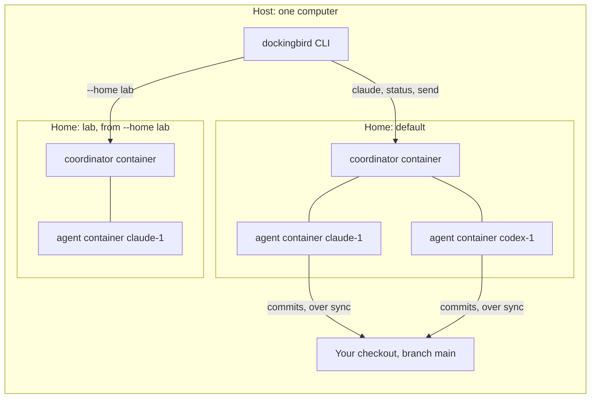

> Part of the Dockingbird customer docs. The index for agents is [llms.txt](../../llms.txt).

Dockingbird starts every agent in a Docker container on your Mac or Linux computer. A folder called a home holds the state of those containers. This page shows how a host, a home and an agent relate, and what carries an agent's commits back to you.

## Hosts, homes and containers

A host is a computer that runs the `dockingbird` command. Each host holds one or more homes. A home is a folder, `~/.local/share/dockingbird` by default, together with the Docker containers, volumes and image that belong to it. A home runs one coordinator container and one container for each running agent. Every agent works in its own copy of your branch, so two agents never overwrite each other and none touches your files.

## How it behaves

The command on the host talks to the home's coordinator. `dockingbird claude` starts Docker Desktop when it is off, builds the image once (about 5 minutes), starts the home, and then starts an agent named `claude-1` in its own container.

Each agent's copy starts from your last commit and sits at `/work/<repo-name>` in the container. The agent never sees edits you have not committed. It runs without permission prompts, because the container is its sandbox.

An agent shares its commits, and `dockingbird sync` brings them to your branch. [The sync model](sync-model.md) describes that path. Your own checkout changes only through `sync` and a few lines Dockingbird adds to `.git/config` and to the ref `dockingbird/<branch>`.

A home turns itself off after 30 minutes with no agent. The next command turns it back on. `dockingbird status` only looks, so it never starts Docker or the home.

A second home on the same computer is a second, separate installation. Run it with `dockingbird --home NAME` or with `DOCKINGBIRD_HOME` set to another folder. It has its own containers, volumes and image tag, and it shares the computer's seat.

Other computers join the picture through `hosts.toml`, which names each one by an ssh destination or a Compute Engine VM. `dockingbird fleet agents --host NAME` then reads that computer's agents, and the fleet pages explain the rest. [Fleet and hosts](fleet-and-hosts.md) covers them.

## Does it need the cloud

Agents run in containers on your computer. Each agent's tool calls its own model API, Anthropic's for Claude Code and OpenAI's for Codex. License check-ins go to the publisher, and the licensing note lists what they send: nothing from a repo or an agent. The [security model](security-model.md) lists what an agent can reach.

## What it never does

- It mounts nothing from your computer into an agent except the folders you connect by name.
- It never gives an agent your uncommitted edits, your home folder, your keychain or your other repos.
- It never pushes a branch you did not connect, and it never runs on a platform other than Apple silicon Macs and arm64 Linux.
- It never starts Docker or a home from `dockingbird status`, which only looks.

## The picture

Text alternative. One host runs the `dockingbird` command and holds your checkout. The host has two homes, the default one and `lab`. Each home has a coordinator container and one container per agent. The command talks to each home's coordinator. The agents' commits reach your checkout only through `dockingbird sync`.

## Guides that use it

| Guide | What it adds |
|---|---|
| [First run](../getting-started/first-run.md) | Starts the first agent and builds the image. |
| [The daily loop](../guides/daily-loop.md) | Starts agents, reads status, syncs and stops. |
| [Hosts](../guides/hosts.md) | Adds a second computer. |
| [Home layout](../reference/files/home-layout.md) | Lists every file under a home. |
| [Clean and uninstall](../guides/clean-and-uninstall.md) | Frees disk and removes a home. |
