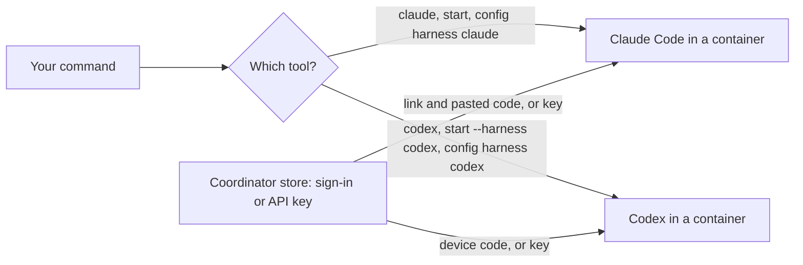

> Part of the Dockingbird customer docs. The index for agents is [llms.txt](../../llms.txt).

Dockingbird runs two coding tools, Claude Code and Codex, and treats them alike wherever it can. This page lists the places where they differ, as the operator guide states them: how each signs in, which flags each takes, and which figures each reports.

## What the two share

Both tools run in a container with their own copy of your branch. Both use the bus, `sync`, trust marks and egress modes in the same way. A config's command runs Claude Code or Codex and never any other program. Everything below is a difference, so a row that is missing is the same for both.

| Topic | Claude Code | Codex |
|---|---|---|
| Start at a terminal | `dockingbird claude` | `dockingbird codex` |
| One-shot form | `dockingbird claude -p "..."`, which a pick-up runs after `--resume <id>` | `dockingbird codex exec "..."`, which a pick-up runs as `exec resume <id>` |
| First sign-in | Its own `claude auth login` runs in the container: open the link, sign in, paste the code | `codex login --device-auth` runs: open the link and enter the one-time code |
| Login reused from your computer | Claude's default profile: a token in `~/.claude/settings.json`, then the Keychain item, then `~/.claude/.credentials.json` | The `auth.json` Codex uses |
| Token from another sign-in | `pbpaste \| dockingbird login claude --oauth-token -` after `claude setup-token` | `cat ~/.codex/auth.json \| dockingbird login codex --auth-json -` |
| API key | `dockingbird login claude --api-key`, an Anthropic key, read through its `apiKeyHelper` | `dockingbird login codex --api-key`, an OpenAI key, taken with `codex login --with-api-key` |
| Gateway for `--base-url` | The origin, to which Claude adds `/v1/...` | A URL that ends in `/v1`, to which Codex adds `/responses` and `/models` |
| Refreshing a sign-in | One live session holds the refresh lease, and the others get a copy without the refresh token | Each session gets the whole `auth.json`, and the last writer wins |
| Your rules file | `--agent-md` and `--claude-md` | `--agent-md` only, because `dockingbird codex --claude-md PATH` is refused |
| `harness_args` in a config | `--model`, `--fallback-model`, `--max-turns` and `--effort` | `--model`, `-m` and `-c model_reasoning_effort=LEVEL` |
| Effort levels | `low`, `medium`, `high`, `xhigh`, `max` | The levels its model takes |
| Compact point | 100K to 1M | Any count of tokens |
| `set` on a running agent | A running Claude gets `/model`, `/effort` and `/autocompact` before its next turn | At a terminal Codex takes no typed command, so `set` names the stop and the pick-up that apply the change |
| `pin` | `pin claude 2.1.285`, and `"stable"` is its slower channel | `pin codex 0.162.1` |
| Cost in `status --json` | `result_cost_usd`, Claude Code's own estimate, in US dollars | None, because Codex names no cost |

## Signing in

Dockingbird reuses the Claude and Codex logins already on your computer. The first start that needs one reads it and keeps a copy in the coordinator's store, and `dockingbird login claude --here` does the same on demand. When you quit a first sign-in, the agent ends with `Claude isn't signed in yet. Run dockingbird claude again to sign in.` Codex ends with the same first sentence, then `(If device code login is off, turn it on in ChatGPT's security settings.)`. Both lines add the API key route.

`dockingbird login claude` or `dockingbird login codex` signs in again, for an expired sign-in or another account, and refuses while that tool's agents run. The last login wins, so either form removes that tool's saved API key. `dockingbird logout claude` and `dockingbird logout codex` remove a sign-in and a saved key.

## Names and one-shots

A name belongs to the tool that first used it. `dockingbird codex --as keep7` for a Claude agent is refused, with the step that picks that agent up. A one-shot prints only the tool's answer on stdout. Without a terminal and without a sign-in it refuses and points at `dockingbird login claude`. A script that pipes nothing into a one-shot closes its input with `< /dev/null`, or Codex waits for input that never ends.

## Choosing the tool

`dockingbird start` runs Claude unless `--harness codex` says otherwise. A config's `harness` key takes `claude` or `codex`, defaults to `claude`, and is fixed once set, so `--harness` cannot change it. A swarm role names its `harness` too. Dockingbird downloads each tool into its program store at the first start and keeps the version you pin in `versions.toml`. `dockingbird pin --clear claude` follows the latest release again.

## What it never does

- It never lends a refresh token to an agent. The copy of a Keychain or login-file sign-in leaves the refresh token out.
- It never answers the trust question of a tool for a checkout you marked untrusted. Claude may ask once per repo, and Codex shows its folder notice each time.
- It never sums the figures a tool reports. Each `result_*` value is the tool's own.
- It never lets `--claude-md` reach Codex, which does not read `CLAUDE.md` at startup.
- It never accepts a `harness_args` flag outside the lists in the table.

## The picture

Text alternative. Your command picks the tool: `claude`, a plain `start` and a config with `harness = "claude"` run Claude Code, and `codex`, `start --harness codex` and a config with `harness = "codex"` run Codex. Each tool runs in its own container. The coordinator's store holds the sign-in or API key, and each agent asks it for its own tool's credential at start.

## Guides that use it

| Guide | What it adds |
|---|---|
| [Sign-in and API keys](../guides/sign-in-and-api-keys.md) | Signs in, signs out and saves a key for either tool. |
| [The daily loop](../guides/daily-loop.md) | Starts either tool at a terminal and picks an agent up by name. |
| [Delegating tasks](../guides/delegating-tasks.md) | Runs a one-shot and uses `set`. |
| [Your own commands](../guides/your-own-commands.md) | Fixes `harness` and `harness_args` in a config. |
| [Updates](../guides/updates.md) | Pins a tool version. |
| [Trust and repo settings](../guides/trust-and-repo-settings.md) | Decides what each tool loads from a repo. |
