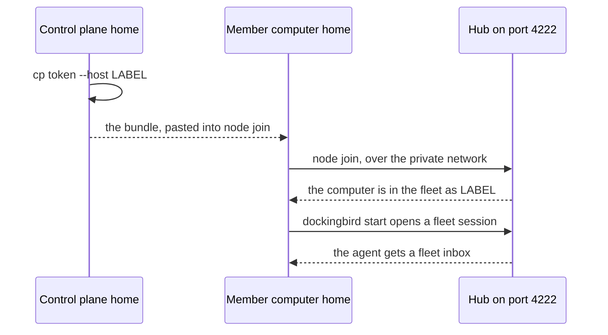

> Part of the Dockingbird customer docs. The index for agents is [llms.txt](../../llms.txt).

# The control plane

This page is for teams. It explains what the control plane is, how a computer joins it and what it holds. The commands are on [the team fleet guide](../guides/team-fleet.md).

A control plane is one Dockingbird home that you turn into the fleet's meeting point with `cp init`. Other computers join it from one of their own homes with `node join`. Once a computer has joined, each agent started on it gets a fleet inbox on the control plane, beside the inbox on its own home. Through that inbox an agent can message an agent on another computer. The control plane and the [fleet scheduler](fleet-scheduler.md) are separate features. A team can use either alone or both together.

## How a computer joins

The control plane's hub listens on a TCP port, 4222, on the control plane's computer. Docker publishes that port on the loopback address only. Until you serve the port to your private network, no other computer reaches it.

`cp token` adds one computer. You give it a label and a platform, and it prints one line, the bundle. The bundle holds the computer's hub address, node id, label, key and token. The control plane shows it once and stores it nowhere. You paste the bundle into `node join` on that computer's home. Each bundle joins once.

Text alternative. On the control plane's home, `cp token --host LABEL` prints a bundle once. You paste it into `node join` on the member computer's home, which reaches the hub on port 4222 over your private network. After that, each `dockingbird start` on the member opens a fleet session on the control plane, and the agent gets a fleet inbox beside its own.

## What a member's agents get

A member's agent is named in the fleet by the computer's label, a dash and the agent's name, such as `lab-notes-1`. A label is one to eight lowercase letters or digits and starts with a letter. An agent whose tools include `bus_send` gets ten fleet tools, listed in [the fleet tools reference](../reference/fleet-tools.md).

An agent reads both inboxes and takes the more urgent delivery first. A choice its tool puts up, or a plan to approve, is asked on the control plane first. When the control plane does not take the question, it is asked on the agent's own home.

When the control plane does not answer at the start, the agent starts all the same and works on its own home. It gets its fleet inbox once the control plane answers.

## What the control plane keeps

For each computer it keeps the computer's public key and a digest of its token. It never keeps the bundle, the computer's private key or the token itself.

A message to a fleet agent whose home is asleep or offline waits on the control plane until that home reads it. At most 200 deliveries wait for one agent.

## What crosses and what stays

A home's work, runs, claims and publication stay on the home. A fleet thread and a home thread are two threads. A message sent in one is never seen in the other, and a home's own `questions` list shows none of the fleet's.

## What it never does

- It never lets one computer read another computer's inboxes.
- It never changes a running agent. `cp remove` ends a computer's fleet sessions, and the agents keep running there without the fleet.
- It never accepts a bundle twice. Joining again takes `cp remove`, a new `cp token` and `node leave` first.
- It never protects a frame better than your network does. Frames between computers are as private as the tailnet or network that carries them.

A computer that was removed or lost its home joins again with a new bundle. The first `dockingbird cp status` after the control plane's computer restarts starts the control plane again. The fleet sessions survive as rows, and every member reconnects by itself.

## Where to go next

- [Install and join with the team fleet guide](../guides/team-fleet.md).
- [Put the hub on a tailnet](../guides/tailscale.md).
- [Cookbook: join a second computer to a control plane](../../examples/join-a-computer-to-a-control-plane/README.md).
