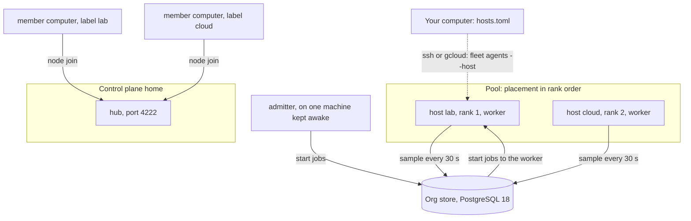

> Part of the Dockingbird customer docs. The index for agents is [llms.txt](../../llms.txt).

Dockingbird keeps two lists of computers, and they do different jobs. The hosts file names the computers your own command reaches. The pool names the hosts a team's scheduler may start swarms on. This page separates them and explains the one name that ties them together.

## The hosts file and the pool

Start with `hosts.toml`, a file in your Dockingbird home. It holds one `[[host]]` table per other computer you reach, and each table has a `name` and one route. The route is `ssh`, with an optional `path` and `docker_host`, or `gcloud` with a `zone` and a `project`. You read a host's agents with `dockingbird fleet agents --host NAME` and open one with `dockingbird fleet attach`. Your own computer is always `local`, and it never appears in the file.

The pool is a separate record. An admin enrols each host in the organisation's PostgreSQL store with `dockingbird fleet hosts add`, and gives it cores, memory, a load line, a rank, an agent cap and a power setting. The scheduler places swarms on pool hosts only. A pool host missing from your file appears in `fleet queue`, but not in `fleet hosts` or `fleet agents`.

## The one-name rule

A host has one name across your hosts file, the pool and every swarm definition. The pool host's name is the `--host` its worker runs under, so set the host in `hosts.toml` under that same name. An admitter that starts a stopped Compute Engine VM finds it by that name in its own `hosts.toml`.

`fleet hosts rename` and `fleet hosts forget` change the file alone. They never touch the pool's records or a swarm definition. With a `fleet.toml` in your home, each refuses a host the pool holds, so you drain and remove it there, rename it in the file, and enrol it again under the new name. A computer's control plane label is a second name, chosen apart, and it may differ from the host name.

## Placement order

The pool orders its hosts by `--rank`, with 1 first and unranked hosts after the ranked ones by name. A definition's `[placement] hosts` lists its preferred hosts. When it leaves `[placement]` out, the swarm may go to every pool host that takes swarms, in pool order. Inside a host, the scheduler picks a home that has a checkout of the repository first, then the home with the fewest running agents, then the first by path. A host whose placed home has no checkout is held with the reason `no_seed`.

## The control plane's home

The control plane is a second feature that shares the word fleet. One Dockingbird home turns into the control plane with `cp init`, and its hub listens on port 4222 of that computer's loopback until you serve it to a private network. Every other computer joins with a bundle from `cp token` and the command `node join`. After that, an agent on one computer can message an agent on another by its fleet name, which is the computer's label, a dash and the agent's name. A team may use the control plane, the scheduler, or both. [The control plane](control-plane.md) has the details.

## Worker and admitter

Two long-running commands do the fleet's work, each under the machine's own service manager. That is a LaunchAgent on a Mac and a systemd user unit on Linux, with `loginctl enable-linger` set so it runs while nobody is logged in.

`dockingbird fleet worker --host NAME` runs once on each machine of the pool. It publishes the machine's sample every 30 seconds and runs the start jobs the admitter gives it. Each agent starts through its home's own `dockingbird start`. The worker then watches what it started. When pause, cancel or done asks, it stops each agent after its running turn.

`dockingbird fleet admitter` runs once, on one machine that stays awake. It admits workloads after every change to the queue or the pool, and at least every 30 seconds. It also does the housekeeping on the same beat: stale hosts, stalled workers, expired leases, and a stopped `gcloud` VM that work is waiting for. When the database does not answer, each command ends with exit 69 and its service manager starts it again. A login the database turns down ends with exit 78.

## What it never does

- It never lets `hosts.toml` hold a pool record. The file names routes, and the pool lives in the store.
- It never saves a host from `fleet hosts set` before it has read that host's Docker and homes.
- It never starts or changes anything on a host when `fleet agents` reads it. The read uses Docker alone.
- It never keeps a database password in `org.toml`. Each role's password is a line of `~/.pgpass`.

## The picture

Text alternative. The organisation's PostgreSQL store sits in the middle. Each pool host runs a worker that publishes its sample every 30 seconds. The admitter, on one machine that stays awake, writes start jobs and the workers run them, in the pool's order. Separately, member computers join the control plane's hub with `node join`. Your computer reaches a host over ssh or gcloud through `hosts.toml`.

## Guides that use it

| Guide | What it adds |
|---|---|
| [Hosts](../guides/hosts.md) | Adds, renames and forgets hosts in the file. |
| [Team fleet](../guides/team-fleet.md) | Installs the store, the worker, the admitter and the control plane. |
| [The fleet scheduler](../guides/fleet-scheduler.md) | Enrols hosts in the pool and runs its queue. |
| [Cloud VMs](../guides/cloud-vms.md) | Adds a Linux VM that an admitter can start. |
| [Hosts file](../reference/files/hosts-file.md) | Lists every key of `hosts.toml`. |
