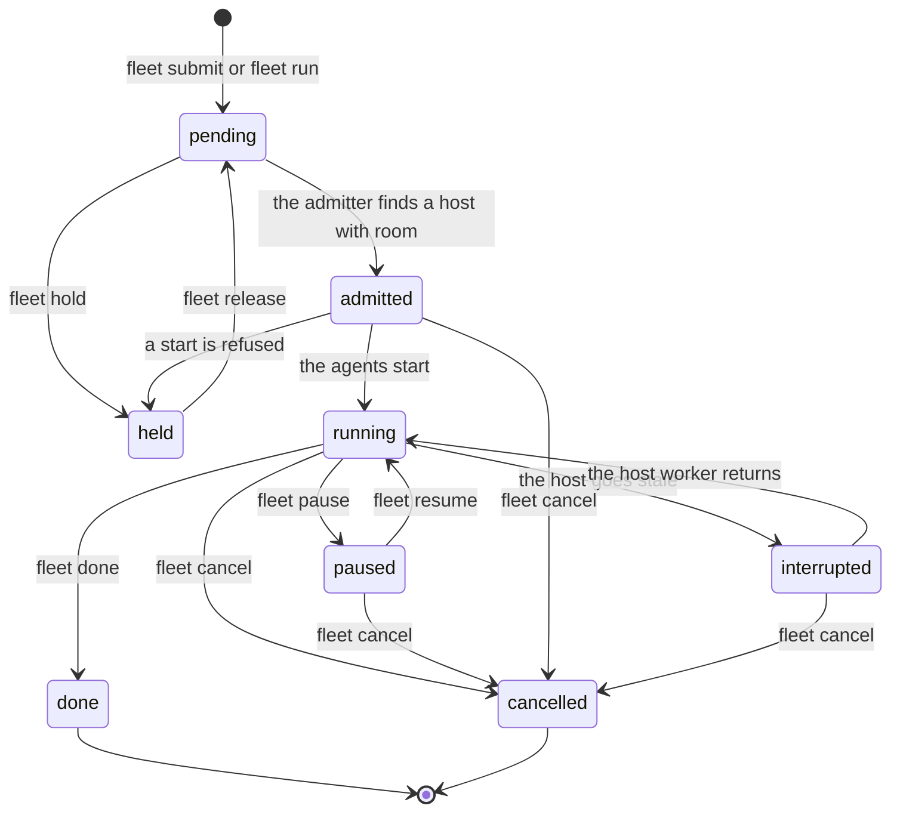

> Part of the Dockingbird customer docs. The index for agents is [llms.txt](../../llms.txt).

# The fleet scheduler

This page is for teams. It explains what the fleet scheduler is, what it decides and what it never does. The commands that run it are on [the fleet scheduler guide](../guides/fleet-scheduler.md).

The fleet scheduler is a pool of hosts and a queue of work, both kept in your organisation's PostgreSQL 18 store. Work is either a swarm (a team of agents from a definition) or a lease (cores and memory for one command). Each host runs a worker. One host of the pool runs the admitter, which looks at the queue and the hosts and starts each workload on a host with room. Every person and every service reaches the store with a login of their own, made with `org login`.

The word "fleet" names two features in Dockingbird. This page is the first, the scheduler behind `dockingbird fleet`. The second is [the control plane](control-plane.md), which lets agents on different computers message each other. A team can use either alone or both together.

## The pool and its hosts

A host joins the pool when the admin enrols it with `fleet hosts add`. A host has one name everywhere: its `[[host]]` name in `hosts.toml`, its name in the pool and the `--host` its worker runs under.

| Property | What it sets |
|---|---|
| cores and memory | the share of the host the scheduler may reserve for workloads |
| gate lines | a live reading each (idle CPU, free memory, disk or I/O pressure) with a bound and a clear value, green or red |
| rank | the host's place in the order the scheduler tries hosts, 1 first, unranked hosts after by name |
| agent cap | the most agents the fullest home on the host may run |
| takes swarms | whether the host accepts swarms or only leases |
| power | `gcloud` lets the admitter start a stopped Compute Engine VM when work waits for it |

A worker publishes its host's sample every 30 seconds: load, free memory and the checkouts its homes link. A host with no sample for 180 seconds is stale, and the swarms placed on it are interrupted until its worker publishes again.

## Workloads

A workload carries a project, a priority from P0 to P3, a reservation and an age. The reservation is the cores, memory and agents the workload needs. A swarm's reservation comes from its roles. A lease's comes from the `--cores` and `--memory` you gave `fleet run`.

The states of a workload are pending, held, admitted, running, paused, interrupted, done and cancelled. A command moves it from one state to the next, except that the admitter moves a pending workload to admitted and a stale host interrupts a swarm. [The fleet scheduler guide](../guides/fleet-scheduler.md) shows the commands for each move.

A workload is submitted, waits as pending, is admitted onto one host, runs, and ends as done or cancelled. `fleet hold` keeps a pending workload out of every pass and `fleet release` puts it back. The scheduler also holds a swarm whose start it refuses, such as one with no checkout, until you fix the cause and release it. `fleet pause` and `fleet resume` stop and restart a running team, each agent stopping after its running turn. A host that stops reporting makes a running swarm interrupted until its worker publishes again. A lease takes `cancel` only. `fleet set --priority` changes a priority in any state but an ended one and keeps the workload's age.

## How the scheduler decides

The admitter admits workloads by priority first, then by age, oldest first. It places a workload on the first host of its placement order that has the room, green gate lines and a home with a checkout of the repository. A swarm without a `[placement]` goes to every pool host that takes swarms, in pool rank order.

A swarm is admitted once the fewest agents of each role (`min`) fit. Agents above that count wait as fill rows and start once the host has room, before any new swarm is admitted. A running swarm therefore grows ahead of a waiting one of any priority.

## Why a workload waits

A workload waits while no host passes every check: its gate lines are green, the host has the cores and memory, a home has room under the agent cap, and a home links a checkout of the repository. `fleet why ID` names the first check each host fails, with the figures. A hold is a reason in its own right. Some holds clear when you fix the cause and run `fleet release`.

| Hold | Meaning |
|---|---|
| `no_seed` | the host's placed home has no checkout of the swarm's repository |
| `no_checkout` | the start found no checkout to use, or the fetch into a clone failed |
| a missing connection | the placed home has no enabled connection of a name one of its roles lists, so no agent started (`fleet why` says which) |
| your own hold | you ran `fleet hold ID --reason TEXT` |

### A held agent

An agent whose start is refused is held. `fleet queue` prints `  held: NAME: REASON` under the swarm with the refusal the start gave. `fleet why ID` prints `NAME is held after REASON; fleet replace or fleet retire frees its slot.` `fleet replace ID NAME` starts the agent again, and `fleet retire ID NAME` gives its slot back. A start refused because the swarm's clone holds an unfinished merge does not hold the agent at once. The fleet puts the start back in the queue for up to 10 claims, about five minutes, and holds the agent only if the merge is still open then.

## The start guard

Before Dockingbird makes an agent's container, a guard on the host checks that the host has room. It runs for every start in every home of the host, whoever asks: you, a coordinator, the MCP server's `agent_start` or the fleet engine. No flag skips it, and it stops, pauses and moves nothing that already runs.

| Order | Check | Refuses with | When |
|---|---|---|---|
| 1 | The agent cap | `HOST_AGENT_CAP` | the home runs 24 agents, counting the starts the host's worker has not sampled yet |
| 2 | The age of the host's reading | `HOST_OVERLOADED`, stale form | the worker's file `guard.json` is older than 180 seconds or does not parse |
| 3 | The host's gate lines | `HOST_OVERLOADED` | a line reads red on that reading, less what the starts not yet sampled hold |

- The cap counts running agents only, in the default home too. A host that runs more than 24 agents needs a second home on it.
- A computer outside the pool has no worker and no `guard.json`, so the cap is its one check.
- A start the fleet engine announced is counted and never refused. So is a start inside a `fleet run` lease that the host runs.
- `dockingbird start --wait TIME` decides again every 30 seconds until the host has room or the time is up.

[Host load protection](../guides/host-load-protection.md) shows each refusal and what to do about it.

## What it never does

- It never stops an agent during a turn. Pause, cancel, done, retire and replace each wait for the running turn to end.
- It never moves a running agent to another host.
- It never holds a password. Each role's password stays in the line of the `~/.pgpass` file on the computer that logs in.
- It never runs a command when the store turns the login down. `fleet run` ends 78 and runs nothing, while a store that does not answer at all makes it run the command without a lease and say so on one line.

## Where to go next

- [Install and run both features](../guides/team-fleet.md).
- [Run work on the pool](../guides/fleet-scheduler.md).
- [Write and change swarms](../guides/swarms.md).
- [Read a start refusal and wait for room](../guides/host-load-protection.md).
- [The store's schemas and roles](../reference/files/fleet-store.md).
