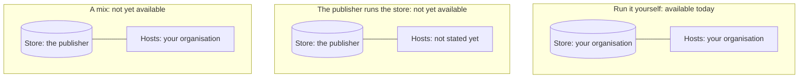

> Part of the Dockingbird customer docs. The index for agents is [llms.txt](../../llms.txt).

Dockingbird's team features keep their records in one PostgreSQL store, and someone has to run that store. This page names the three ways to arrange it, says who runs the store and the hosts in each, and marks the one you can use today.

## The three paradigms

| Paradigm | Who runs the store | Who runs the hosts | Available |
|---|---|---|---|
| Run it yourself | Your organisation, on its own machines or cloud | Your organisation | Yes, today |
| The publisher runs the store | The publisher | Not stated yet | Not yet available |
| A mix | The publisher | Your organisation's own hosts | Not yet available |

In all three, the seat is one person with up to three computers, and license check-ins go to the publisher.

## Run it yourself

This is the one arrangement you can use today. Your organisation runs a PostgreSQL 18 store and creates its schemas with `dockingbird org create`, run as the `fleet_admin` role. `dockingbird org login` points each computer at the store, and the login's password stays in `~/.pgpass`, never in the pointer file. Each pool machine runs a worker, and one machine that stays awake runs the admitter. Your own computers or cloud VMs are the hosts, reached over your own ssh or gcloud. A control plane, if your team uses one, is yours too: its NATS hub runs on your own computer or VM, as [Run your own control plane](../guides/control-plane-setup.md) shows.

You do not need the store for every setup. One computer needs nothing beyond `dockingbird claude`. A second computer needs only a `hosts.toml` entry and an ssh or gcloud route. The store matters when a team shares a queue and a pool.

| Your setup | What you need |
|---|---|
| One computer | The install and a license seat. |
| Two or more computers you reach yourself | A `hosts.toml` entry for each, over ssh or gcloud. |
| A team that shares a queue of swarms | The store, a worker on each host and one admitter. |

## The two arrangements that are not yet available

In one, the publisher runs the store. In the other, a mix, the publisher runs the store and your own hosts run the agents. Neither is available yet, and no guide covers them.

## What it never does

This page documents only the first arrangement, because the other two do not work in the current release. No arrangement sends the contents of a repo or an agent's output to the publisher through licensing. Today the publisher sees license check-ins and nothing else of yours, since you run the store.

## The picture

Text alternative. Only the first of the three setups works today. There, your organisation runs both the store and the hosts. The other two put the store with the publisher, and one of them keeps the hosts with your organisation, but neither is available yet.

## Guides that use it

| Guide | What it adds |
|---|---|
| [Choose a topology](../getting-started/choose-a-topology.md) | Picks one computer, two computers, a cloud VM or a team pool. |
| [Team fleet](../guides/team-fleet.md) | Installs the store, the worker, the admitter and the control plane. |
| [Run your own control plane](../guides/control-plane-setup.md) | Runs the control plane and its hub alone, with no store. |
| [The fleet scheduler](../guides/fleet-scheduler.md) | Runs the pool once the store exists. |
| [Hosts](../guides/hosts.md) | Adds a second computer without a store. |
| [The team fleet example](../../examples/team-fleet/README.md) | Shows a pool of two hosts. |
