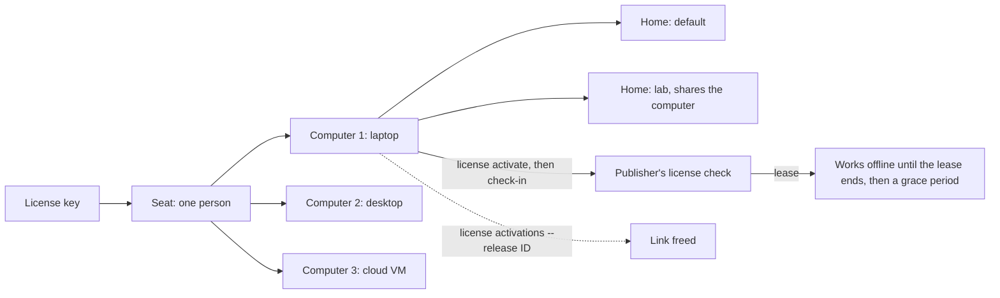

> Part of the Dockingbird customer docs. The index for agents is [llms.txt](../../llms.txt).

You buy seats, one for each person. Each seat links up to three of that person's computers, for example a laptop, a desktop and a cloud VM. The sections below cover how a computer is counted, how check-ins and offline days work, and why this release never blocks your work.

## Seats and computers

A seat is one person. A laptop, a desktop and a cloud VM can all belong to that seat, on arm64, the only platform Dockingbird runs on. A second Dockingbird home on the same computer, made with another `DOCKINGBIRD_HOME`, shares that computer's link. Agents, containers and repos are never counted.

`dockingbird license activate` links the computer you run it on. It asks for your key with the typing hidden, or reads it from standard input, and it refuses a key given as a word on the command line with exit 2. A computer is known by an identifier kept in its license file. A re-imaged VM, a cloud instance recreated on every deploy, and a container or CI runner without a machine id each get a new identifier, so each counts as a new computer every time.

When all the computers a license admits are linked, activation refuses with exit 1. Free one with `dockingbird license activations --release ID`. Better, run `dockingbird license deactivate` or `dockingbird clean --all` before you destroy a computer. A link nobody released stops counting by itself after 90 days. `dockingbird license trial` starts a trial on a computer with no key, once per computer.

## Check-ins and offline use

This release does not enforce licensing. A start reaches no network and downloads nothing. It runs the license client only when one is already on the computer, prints one line for any state but a valid license or none, such as `agents start because licensing isn't enforced yet`, and then the agent starts.

Once licensing is enforced, a start whose last check-in is older than a day checks in with the publisher first. A failed check-in never stops the start. Without a check-in, the license keeps working for its lease, so a computer that is offline, or an outage at the publisher, interrupts nothing.

When the term nears its end, when a computer has been offline a while, or when the term has ended and its grace period runs, a start prints one line and the agent starts. Past the grace period, a start is refused before anything runs, with exit 1, the reason, and the next step. The step is `dockingbird license activate`, `dockingbird license status --refresh` or `dockingbird update`. `dockingbird license status` shows when the lease ends.

## The end of a term

`dockingbird license status` shows the state, the plan, the seats and the end of the term from the license file, with no network. `--refresh` checks in first. After a term ends, the installed version keeps working. New releases need the license renewed, because the release index serves current licenses only.

## Three ways to run it

Today you run the organisation's store and your hosts yourself. Two other arrangements are planned, one where the publisher runs the store and one that mixes the two, and neither is available yet. [Hosting paradigms](hosting-paradigms.md) sets the three side by side.

## What it never does

Ten commands ignore licensing: `sync`, `stop`, `clean`, `status`, `results`, `read`, `inbox`, `serve`, `update` and `login`. You always get your work back. A running agent keeps running, and reconnecting to it is not a new start. Nothing from a repo or an agent goes to the publisher. A key never travels on the command line, so it stays out of your shell history and out of `ps`.

## The picture

Text alternative. One key gives a seat to one person. The seat links up to three computers, here a laptop, a desktop and a cloud VM. Two homes on the laptop share its single link. A computer activates and checks in with the publisher's license check, which gives it a lease. The computer works offline until the lease ends, then a grace period runs. `license activations --release ID` frees a link.

## Guides that use it

| Guide | What it adds |
|---|---|
| [Activate](../getting-started/activate.md) | Activates the first computer and reads the done lines. |
| [Licensing](../guides/licensing.md) | Frees a seat, moves it to a new laptop and reads each refusal. |
| [Clean and uninstall](../guides/clean-and-uninstall.md) | Gives the seat back while removing everything. |
| [Data and privacy](../guides/data-and-privacy.md) | Lists what a check-in sends. |
