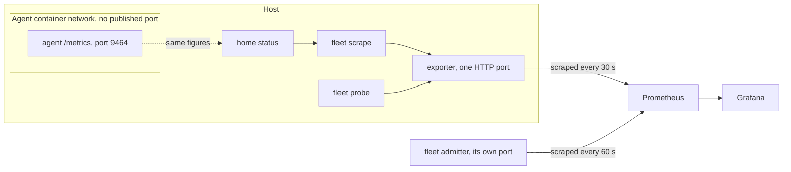

> Part of the Dockingbird customer docs. The index for agents is [llms.txt](../../llms.txt).

# Observability

This page explains where Dockingbird's figures come from, how fresh each source is, and what none of them hold. Three sources exist. An agent reports its own context, turns and cost. A host reports its load and memory. The fleet scheduler's admitter reports the queue and the room left on each host. All three use the Prometheus text format, so any Prometheus can collect them and any Grafana can draw them.

## The three sources

| Source | What it holds | How fresh | How you read it |
|---|---|---|---|
| An agent | Its model and effort, turns, context in use against the window and the compact point, compactions, changed and untracked paths, sign-in and token trouble, bus losses, API retries, tokens and cost per model, and its last result | As old as the last figures its container wrote: its last turn's end, its last renewal or its last change, seconds to a minute behind | `dockingbird fleet scrape` on the host |
| A host | Cores, load against the load line, idle cores, free memory, swap, Docker's CPUs and memory, containers running, and each kind of process with its CPU, memory and count | As old as the run that read it | `dockingbird fleet probe` on a Mac |
| The admitter | Queue depth by priority, reserved and spare room per host, red gate lines, stale hosts, interrupted workloads, holds by reason, counters of admissions, starts, queue wait and agent seconds | Updated by each admission pass, which runs after every change to the queue and at least every 30 seconds | `dockingbird fleet queue --metrics`, or the admitter's own port |

Every agent container serves its figures at `GET /metrics` on port 9464, inside its own container network. On Docker no port of the computer reaches that port. The host renders the same text itself with `fleet scrape`, from the home's `status`, and connects to no container. Each line carries the labels `profile` (the home), `agent`, `session` and `tool`. An agent of a swarm also carries `team` and `role`.

The agent families are gauges. Cost and tokens count from the start of an agent's process for Claude, or of its thread for Codex. They fall back to zero when it restarts. A window query on them therefore uses `delta()` or `deriv()`, and a restart shows as a negative step. `rate()` and `increase()` fit only the counters that end in `_total`, which the admitter serves.

Codex reports less than Claude. Its agents show no cost and no API retries, and its per-model tokens and compactions stay empty until its rollout has been read. [The metrics reference](../reference/metrics.md) lists every family with its type and labels.

## What stays out

No source holds the text of a message, the content of a repository, or a name that a program printed. The probe shows numbers and kinds of process only. The agent figures carry an agent's name, session and tool as labels and nothing it wrote. Reading figures starts, stops and changes nothing: `fleet probe`, `fleet read-home` and `fleet scrape` only look.

## The metrics path

Text alternative. Inside the host, an agent's container serves `/metrics` on a port that only its own container network reaches. The agent's figures also reach the home's status. `fleet scrape` reads that status and renders the same text, and `fleet probe` reads the host. A small exporter on the host joins the two and serves one page on one HTTP port. Prometheus scrapes that page every 30 seconds and the admitter's port every 60 seconds. Grafana reads from Prometheus. Nothing is published from the container.

## Guides that use it

- [Read the figures by hand](../guides/metrics.md) shows each command and its output.
- [Collect them with Prometheus](../guides/prometheus.md) runs the exporter and the two scrape jobs.
- [Draw them in Grafana](../guides/grafana.md) imports the default dashboard and sets three alerts.
- [The fleet scheduler](fleet-scheduler.md) explains the admitter that serves the third source.
- [The architecture](architecture.md) shows hosts, homes and containers.
