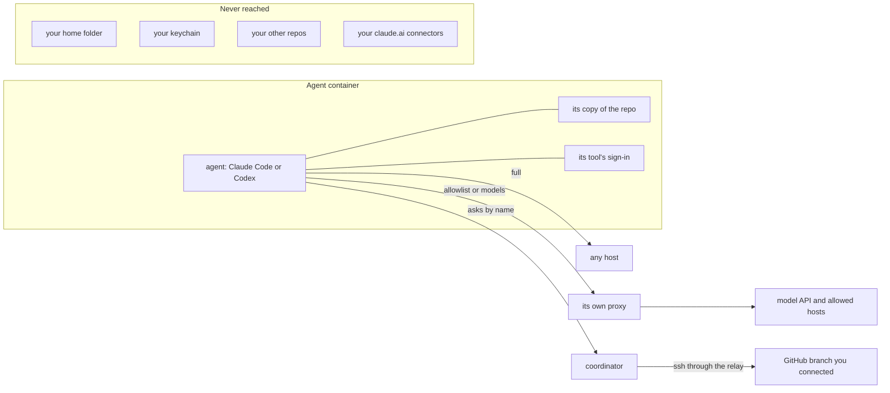

> Part of the Dockingbird customer docs. The index for agents is [llms.txt](../../llms.txt).

A coding agent runs commands you never typed, so Dockingbird runs each agent inside its own Docker container. This page lists what that container can reach, what it cannot, where secrets live, and what `dockingbird clean --all` takes away.

## What an agent can reach

An agent reaches its own container and its own copy of one branch at `/work/<repo-name>`. It also reaches the folders you connected by name, read-only unless a config grants write, and the message bus. It can read its tool's own sign-in or saved API key, but it cannot change it. Its network depends on the egress mode.

| Egress mode | What the agent reaches |
|---|---|
| `full`, the default | Its own network with NAT out and no proxy, so any host. |
| `allowlist` | Its tool's own hosts, the hosts of its presets and the hosts of its config's `allow`, through a proxy of its own. The presets are `registries` and `github`. |
| `models` | Its tool's own hosts alone, through a proxy of its own. |
| `none` | No network at all, the model API included. |

You set the mode with `--egress MODE` on a start, with `egress` in a config, or for new agents with `dockingbird egress MODE`. A host outside the list gets the proxy's `407` and a message that names Dockingbird and the way out. The proxy tunnels TLS and sees only the host name and port. In both proxy modes it refuses every address that is not public, so an agent cannot reach your Mac, your LAN or another agent through it. A proxy mode needs Docker Engine 28 or later.

## What an agent cannot reach

No agent has a bind mount except the folders you connected. Your home folder, your keychain and your other repos are therefore out of reach. Nothing under `~/.claude` is mounted for it, and the refresh token of your Mac's own login never leaves your Mac. Your claude.ai connectors never load in an agent, in any egress mode. Each agent sits on a network of its own, so two agents share no channel except the bus.

## Where secrets live

A connection holds the secret and the agent holds only the name. A GitHub key, a database password and a vault passphrase stay inside Dockingbird. The coordinator is the only container that holds them, and it has no network except ssh to the hosts of your connections. An agent asks it for a fetch, a push or one SQL statement, and never gets the key or the password.

Each tool's sign-in and saved API key live in a Docker volume that no agent mounts. An agent asks the coordinator for its own tool's credential at its start. A key you save goes through a container's standard input and never appears in an argument, a container environment, `docker inspect`, a log or a file on your Mac.

## What stays open

The default mode `full` lets a hijacked agent send out the repo it works on and its own Docker sign-in or key to any host. `dockingbird egress allowlist` closes that for agents you start from then on. An `allowlist` entry names a host and not a port, so an allowed host is open on every port. Prompt injection through repo content is not addressed. Every container runs as your uid, and an agent can fill its copy or Docker's disk until `clean` frees it. A browser you lend with `serve` loads pages through your computer's network, and in your own browser the agent acts as you on every site you are signed in to.

## What clean removes

`dockingbird clean --all` removes this installation's containers, its five volumes, every agent's dependency cache and its images. The volumes hold every agent's copy and history, the sign-ins and the saved key, the tools' store and the toolchains. It also removes the links Dockingbird added to your checkouts' `.git/config` and the refs `dockingbird/<branch>`, and the files in the home. It gives the seat back first. A `config.toml` you wrote stays, and so does the empty `logs/` folder. Before it removes anything, it lists each agent still working and each copy that holds work. `dockingbird disconnect NAME` removes one connection's copy of a key.

## What it never does

Dockingbird mounts no home folder, keychain or other repo into an agent. No command of it shows a secret on a screen, in a log or on a command line. Your claude.ai connectors stay off in every agent. The proxy tunnels an agent's TLS traffic without opening it, so the tool's own certificate check runs against the real server.

## The picture

Text alternative. The agent container holds the agent, its copy of the repo and its tool's sign-in. In `allowlist` and `models` the agent's traffic leaves through its own proxy to the model API and the allowed hosts. In `full` it goes to any host. For a connection the agent asks the coordinator by name, and the coordinator reaches the GitHub branch you connected over ssh. Your home folder, your keychain, your other repos and your claude.ai connectors are never reached.

## Guides that use it

| Guide | What it adds |
|---|---|
| [Egress and network](../guides/egress-and-network.md) | Sets a mode, an allowlist and a proxy. |
| [Connections](../guides/connections.md) | Gives agents a repo, folder, database or browser without the secret. |
| [Sign-in and API keys](../guides/sign-in-and-api-keys.md) | Signs in and saves a key. |
| [Trust and repo settings](../guides/trust-and-repo-settings.md) | Decides what a repo's own settings load. |
| [Clean and uninstall](../guides/clean-and-uninstall.md) | Removes agents, volumes and the home. |
| [Data and privacy](../guides/data-and-privacy.md) | Lists what leaves the computer. |
