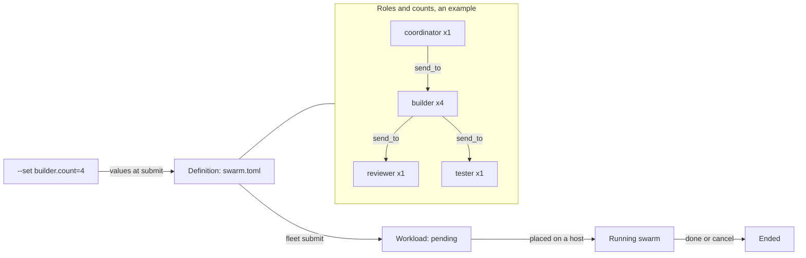

> Part of the Dockingbird customer docs. The index for agents is [llms.txt](../../llms.txt).

You describe a team of agents in one TOML file, for example four builders, a reviewer and a tester. The fleet scheduler then starts that team on a host of your pool. Below are the parts of the file, the values you give at submit, and the workload that results.

## The definition

A definition is a TOML file at `schema = 1`. It names a `project`, a `priority` from P0 to P3, the `[source]` repository and branch the agents work on, and an optional `[placement]` list of hosts. Each kind of agent is one `[[role]]` table. A `key` makes the definition repeatable: a second submit with the same key answers the swarm that was queued first. Without a `key`, every submit queues a new swarm, keyed by its name and the UTC time. The [team fleet example](../../examples/team-fleet/swarm.toml) places a reviewer, a tester and two builders.

## Roles

A role is one kind of agent. It names a `harness` (`claude` or `codex`), a `count`, and a `brief`, a Markdown file that is the agent's first task. It may add `min` and `max`, the fewest agents a retire leaves and the most an add reaches. Both default to the count. A role marks its job with `reviews` or `tests`, which name the roles whose commits it checks.

The model and the effort come from the first place that gives them: the role, then `[roles.<kind>]` in `.dockingbird/project.toml`, then your organisation's store. A role that none of them covers is refused. A role's kind is `reviewer` when it reviews, `tester` when it tests and `implementer` otherwise, unless it names its own `kind`.

A role can take its settings from a library. `use = "<name>"` reads `.dockingbird/roles/<name>.toml` in the project. `use = "dockingbird/<name>"` reads one of the roles Dockingbird ships: `coordinator`, `implementer`, `reviewer`, `tester` and `reader`. `dockingbird init` copies those into the project, and a copy you edited survives a later `init`. Each key the swarm gives replaces the library role's.

A role's `send_to` lists the roles whose agents it may message besides its parent. An empty list means the parent alone. Leaving it out lets the agent message any agent of the project. Any other send is refused with `FORBIDDEN`.

## Values at submit

A definition may declare `[params]`, each an `int`, a `choice` or a `text` with a default and bounds, and write `{{name}}` in its values and texts. `dockingbird fleet submit NAME --set N=4` gives one value, and `--set grader.count=6` sets a role's count. `--values FILE` takes a JSON document shaped `{"params": {...}, "roles": {"<role>": {...}}}`. A `--set` beats the file for the same key.

A submit may set a role's `count`, `min`, `max`, `model`, `effort`, `compact_at` and `session_hours`. `dockingbird fleet describe NAME` prints every parameter and settable field as JSON and connects to nothing. A submit checks every rule before it stores anything, prints each refusal as `refused: <field>: <rule>`, and exits 1.

## What a workload is

A workload is the unit the scheduler queues, and it is either a swarm or a lease. A successful submit prints `<id> pending, position <n>`, and that id names the workload in every later command. The controls `hold`, `release`, `pause`, `resume`, `cancel` and `done` take it. [The fleet scheduler](fleet-scheduler.md) explains how a workload waits and how it is admitted.

Agents the fleet starts get `--compact-at 500000` and `--session-hours 48` unless their role names its own. An agent that hands its parent a message beginning `status: done` is retired on its own word.

## What it never does

- It never stops an agent during a turn. `pause`, `cancel`, `done` and `retire` each wait for the running turn to end.
- It never queues a definition that breaks a rule. Nothing is stored when a refusal prints.
- It never starts a second swarm for a repeated `key`.
- It never places a swarm on a host whose home has no checkout of the repository, and `fleet why` names that hold `no_seed`.
- It never lets a role drop a tool of the bus set.

## The picture

Text alternative. A definition lists its roles and their counts, here one coordinator, four builders, one reviewer and one tester. The `send_to` edges show who may message whom: the coordinator reaches the builders, and the builders reach the reviewer and the tester. Values such as `--set builder.count=4` enter at submit. `fleet submit` turns the definition into a pending workload, the scheduler places it on a host, and `done` or `cancel` ends it.

## Guides that use it

| Guide | What it adds |
|---|---|
| [Swarms](../guides/swarms.md) | Writes a definition, submits it and changes a running swarm. |
| [The fleet scheduler](../guides/fleet-scheduler.md) | Follows the queue and uses the controls. |
| [Team fleet](../guides/team-fleet.md) | Installs the store, the worker and the admitter first. |
| [Swarm definition](../reference/files/swarm-definition.md) | Lists every key of a definition. |
| [Roles and connections](../reference/files/roles-and-connections.md) | Lists the keys of a library role. |
