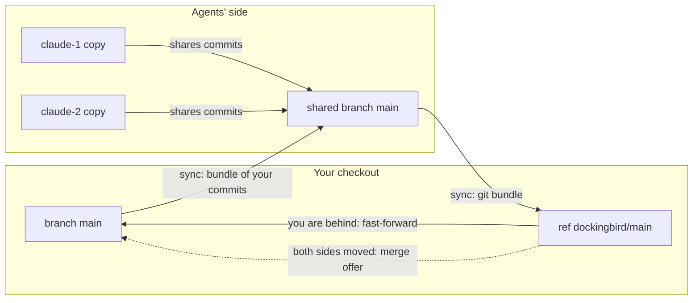

> Part of the Dockingbird customer docs. The index for agents is [llms.txt](../../llms.txt).

You and your agents each hold a branch of the same project, and `dockingbird sync` is the one command that moves commits between them. It works in both directions, as git bundles. This page describes what it does in each situation and what it refuses to carry.

## Where the commits live

Each agent works in its own copy of your branch, made from your last commit. It never sees edits you have not committed. When an agent shares commits, they collect on the agents' side. `dockingbird sync` runs on the branch you are on, in the checkout you run it in, and brings those commits over as a git bundle. Git reads the bundle with `index-pack --strict` into the ref `dockingbird/<branch>`.

Sync names each commit with the agent that shared it. It takes that name from Dockingbird's own record and never from the commit's author field. Two agents on one branch each work in their own copy, and sync names the agent behind every commit it brings.

## What sync does in each case

| Situation | What sync does |
|---|---|
| You are behind | Fast-forwards your branch at once and lists each commit with its agent. |
| You are ahead | Sends your commits as a bundle, only what the agents lack. |
| Both sides moved, at a terminal | Asks `Merge theirs into yours now? [Y/n]`. Yes runs your own `git merge` with sync's protections, then sends the merge. |
| Both sides moved, no terminal | Prints the look-first command `git log -p main..dockingbird/main` and `When you are ready: git merge dockingbird/main, then dockingbird sync`. |
| The merge conflicts | Leaves the merge for you to finish. A merge in progress stops every later `sync` and `start` until you commit it. |
| The agents' copy was changed outside Dockingbird | Pauses sharing and loses nothing. `dockingbird sync --accept COMMIT` goes on from the commit sync names. |
| You made the branch again under its old name | `dockingbird sync --let-go` asks once, names what goes, and makes your branch the branch. |

Your uncommitted edits stay as they are. Only when the agents changed a file you are editing, ignored files included, does sync change nothing and name the files. Commit or stash them and run it again. After a good sync, each other linked branch of the same checkout that lacks the agents' commits gets one line with the step that takes them.

## Turning a commit down

Don't want an agent's commit? Commit its opposite. `git revert COMMIT` writes the revert on your branch, and the next `dockingbird sync` sends it to the agents. A reset or a deleted branch removes nothing. The agents' copy still holds the commit, so the following sync brings it back to you.

## What is refused before anything is bundled

Sync refuses a branch that holds a symlink to an absolute path, one that leaves the repo or points into `.git`, a chain of symlinks that is too long or loops, a symlink with an unusable target, a submodule or a Git LFS file. It names each file with its kind, at most 100 at a time. A symlink whose relative target stays inside the repo goes through as it is. When the commits sync takes add a symlink or change where one points, it notes each one with its target.

## The protections your git runs with

Every git call sync makes in your checkout runs `/usr/bin/git` with a scrubbed environment. Hooks are off through `core.hooksPath=/dev/null`, and so are fsmonitor, submodule recursion and git's automatic gc. No transport is allowed, and `GIT_LFS_SKIP_SMUDGE=1` keeps an LFS download or hook from running here.

Like your own `git pull`, sync follows the agents' `.gitattributes`, so a filter or merge driver your git config defines runs when they name it. When your hooks folder sits inside the work tree and the incoming commits change it, sync merges nothing and names the files. When the agents changed `.gitattributes`, `.gitmodules` or `.lfsconfig`, sync shows the new lines. Review the agents' commits before you build or run them.

## Kept copies

An agent that stops with work not shared keeps its copy and holds its name. `dockingbird status` lists it under "Needs your attention" with the command that picks it up, and `dockingbird claude --as NAME` continues it. A copy kept on another branch gets a step such as `git switch feature/r7, then dockingbird claude --as keep7`. `dockingbird clean` removes a provably empty copy at once and asks about every other one, with the default answer No.

## What it never does

- It never changes your uncommitted edits.
- It never runs your git hooks, an LFS download or a submodule update during a sync.
- It never merges on a terminal without asking, and Ctrl-C at the question merges nothing and exits 130.
- It never drops an agent's commit because you reset your branch.
- It never takes the author field as the agent's name.

## The picture

Text alternative. Two agents each work in their own copy and share commits to the shared branch on the agents' side. `sync` carries that branch to your checkout as a bundle and lands it in the ref `dockingbird/main`. From there it fast-forwards `main` when you are behind, or offers a merge when both sides moved. Your own commits travel back to the shared branch in a bundle.

## Guides that use it

| Guide or entry | What it adds |
|---|---|
| [The daily loop](../guides/daily-loop.md) | Runs `sync`, `sync --accept` and `sync --let-go` in a normal day. |
| [Clean and uninstall](../guides/clean-and-uninstall.md) | Frees disk and removes kept copies. |
| [SYNC_UPDATED](../troubleshooting.md#sync_updated) | The line printed when sync took the agents' commits. |
| [SYNC_BOTH_MOVED](../troubleshooting.md#sync_both_moved) | The line printed when you and the agents both have new commits. |
| [SYNC_CONFLICTS](../troubleshooting.md#sync_conflicts) | The line printed when the merge stops on conflicts. |
| [SYNC_TREE_POLICY](../troubleshooting.md#sync_tree_policy) | The refusal for a symlink, a submodule or an LFS file. |
