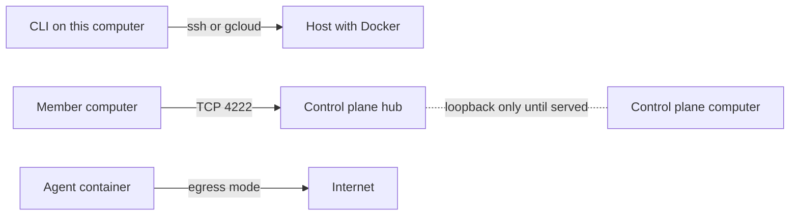

> Part of the Dockingbird customer docs. The index for agents is [llms.txt](../../llms.txt).

# Networking

Dockingbird uses a network in three ways, and each needs one thing reachable. This page names the three, shows the check for each, and lists what no route needs. Pick the guide for your network from the table at the foot.

## The three routes

| Route | Who talks to whom | Carried by | What must be reachable |
|---|---|---|---|
| Host route | the CLI on this computer to a host's Docker | your own ssh, or your own `gcloud compute ssh` | the host's ssh, as your own configuration reaches it |
| Hub route | a member computer's fleet-link to the control plane's hub | TCP, port 4222 | the control plane computer's hub port, served to your private network |
| Egress route | an agent's tool to the internet | the agent's own network, through a proxy in the proxy modes | the hosts the egress mode allows |



Text alternative: the CLI reaches a host over ssh or gcloud. A member computer reaches the control plane's hub on TCP port 4222, which Docker publishes on the control plane computer's loopback until you serve it to your private network. An agent reaches the internet only as far as its egress mode allows.

A team that runs the fleet scheduler has a fourth route, from each host to the fleet's PostgreSQL database. It uses the `host` and `port` of the org login, and a host that cannot reach it ends its fleet commands with exit 69 ([team fleet](team-fleet.md)).

## Before you start

- Dockingbird is installed on each computer. `dockingbird --version` prints a version when it is.
- You know which routes you need. One Mac on its own talks to no other computer, so it needs only the egress route.
- You know what private network joins your computers. It may be a tailnet, a plain VPN, a bastion, a cloud network or Compute Engine, and the table at the foot names the guide for each.

## Check the host route

```bash
ssh lab.example docker version
dockingbird fleet hosts set lab --ssh lab.example
```

The first command is the one Dockingbird runs itself, so a problem shows there first. The second adds the host once a read has worked, and its last line is the done line.

```text
lab: ssh lab.example, saved in ~/.local/share/dockingbird/hosts.toml.
```

A Compute Engine VM goes through your own gcloud in the same two steps.

```bash
gcloud compute ssh cloud-1 --zone europe-west1-b --project example-project -- docker version
dockingbird fleet hosts set cloud --gcloud cloud-1 --zone europe-west1-b --project example-project
```

Neither route needs anything beyond what your own ssh or gcloud already uses. Dockingbird waits 15 seconds for a host to answer, and each read of its agents gets 20 seconds.

## Check the hub route

`cp init` turns one home into the control plane, given the address at which the other computers reach its hub.

```bash
dockingbird cp init --hub-address <ipv4>
dockingbird cp token --host lab --platform linux
dockingbird node join
dockingbird cp status
```

Run `cp init` and `cp token` on the control plane's home, and `node join` on the member's home. The done lines follow.

```text
This home is now the fleet's control plane, at <ipv4>:4222.
This computer joined the fleet as lab (node NODE_ID).
```

The first is `CP_INITIALIZED` and the second `NODE_JOINED`. `cp status` then lists the computer with its state, its version and how long ago the control plane heard from it. The hub listens on port 4222 of the control plane's computer. Docker publishes that port on the computer's loopback only, so nothing on the network reaches it until you serve it ([Tailscale](tailscale.md) shows the serve line; [other networks](other-networks.md) says what is documented for a plain VPN). Frames between computers are as private as the network you serve the port to.

A member that loses the hub finds it within 40 seconds, then reconnects by itself. Fleet calls are refused at once meanwhile, and a call waits at most 30 seconds for its answer. The agents keep working on their own home. The hub takes at most 1024 connections, one for each member and one for the control plane.

## Check the egress route

```bash
dockingbird egress
```

With nothing set, it prints Dockingbird's own default.

```text
Egress for new agents: full.
Nothing is set: this is Dockingbird's own default.
```

| Mode | What the agent reaches |
|---|---|
| `full` | the agent's own network with NAT out, no proxy; the default |
| `allowlist` | its tool's own hosts, the hosts of its presets and of its config's `allow`, through a proxy container |
| `models` | its tool's own hosts alone |
| `none` | no network at all, the model API included |

Two presets exist, `registries` and `github`, and [ports and hosts](../reference/ports-and-hosts.md) lists the hosts each one covers.

```bash
dockingbird egress allowlist --allow docs.python.org
```

That command sets the default for new agents, and agents already running keep theirs (`EGRESS_SET`). To change one start only, give `--egress MODE` to `claude`, `codex` or `start`.

A host outside the list gets a `407` from the proxy. The tool then fails with its own proxy-refused error, and not with a timeout. The proxy also refuses every address that is not public, so your LAN and `host.docker.internal` fail even when you list them. A proxy mode needs Docker Engine 28 or later, and the full rules are in [egress and network](egress-and-network.md).

## What nothing else needs

- No route between agents. Each agent is on a network of its own that no other agent joins, and its one channel to another agent is Dockingbird's message bus.
- No published port for an agent's metrics. Each agent's container serves `/metrics` on port 9464 inside its own network, and no port of the computer reaches it.
- No public port on the control plane's computer. Docker publishes the hub's port on loopback, and you choose the network that reaches it.
- No copy of an ssh key. Dockingbird runs your own ssh and gcloud with your own configuration.

[Ports and hosts](../reference/ports-and-hosts.md) lists every port and host in one table.

## Pick your network

| Your network | Guide |
|---|---|
| a tailnet | [Tailscale](tailscale.md) |
| a plain VPN, a WireGuard mesh, a bastion, a cloud network | [other networks](other-networks.md) |
| a Linux VM as a host | [cloud VMs](cloud-vms.md) |
| the cookbooks | [a fleet on a tailnet](../../examples/fleet-on-a-tailnet/README.md), [a host behind a bastion](../../examples/host-behind-a-bastion/README.md) |

## When it fails

- [`FLEET_HOSTS_NOT_REACHED`](../troubleshooting.md#fleet_hosts_not_reached): the host route failed; the message gives the command to try.
- [`FLEET_HOST_NOT_READ`](../troubleshooting.md#fleet_host_not_read): `fleet agents` could not read the host.
- [`CP_ALREADY_INITIALIZED`](../troubleshooting.md#cp_already_initialized): this home is already the control plane; nothing changed.
- [`MODE_CHANGE_AGENTS_RUNNING`](../troubleshooting.md#mode_change_agents_running): `cp init` and `node join` need the home's agents stopped.
- [`NATS_SERVER_UNAVAILABLE`](../troubleshooting.md#nats_server_unavailable): the hub did not answer in time; run the command again.
- [`FLEET_SESSION_NOT_OPENED`](../troubleshooting.md#fleet_session_not_opened): an agent started without a fleet inbox because the control plane was asleep, unreachable, at another version or refused the credential.
- [`FLEET_LINK_START_FAILED`](../troubleshooting.md#fleet_link_start_failed): Docker refused to run the fleet-link; the next command tries again.
- [`NODE_VERSION_MISMATCH`](../troubleshooting.md#node_version_mismatch): the member and the control plane run different versions; update the one behind.
- [`EGRESS_PROXY_FAILED`](../troubleshooting.md#egress_proxy_failed): the proxy of an `allowlist` or `models` start did not come up; run again.
- [`START_NETWORK_POOLS_FULL`](../troubleshooting.md#start_network_pools_full): Docker has no address range left for the agent's network.
- [`EGRESS_ENTRY_INVALID`](../troubleshooting.md#egress_entry_invalid): an `--allow` entry is not a host or a preset. Exit 2.
- [`EGRESS_FILE_INVALID`](../troubleshooting.md#egress_file_invalid): `egress.toml` cannot be read, so no new agent starts until `dockingbird egress --reset`.
