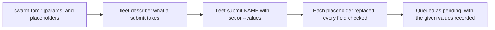

> Part of the Dockingbird customer docs. The index for agents is [llms.txt](../../llms.txt).

# Swarm parameters

This guide for teams reuses one swarm definition for many swarms by changing its parameters alone. A definition declares parameters in a `[params]` table and writes `{{name}}` where a value goes. Each `fleet submit` then gives the values, per submit, with `--set` or a JSON file. The definition file is never edited between submits. [The swarms guide](swarms.md) covers the rest of a swarm's life, and [the definition reference](../reference/files/swarm-definition.md) lists every key.

## Before you start

- The prerequisites of [the swarms guide](swarms.md) hold. You have a working pool, project membership and a checkout with a linked home.
- You run every command inside a checkout whose top holds `.dockingbird/`. A definition name resolves to `.dockingbird/swarms/NAME/swarm.toml` there.
- The definition below names a library role, `use = "grader"`. Its file is `.dockingbird/roles/grader.toml`, shown in step 1.

## One definition, three submits



Text alternative. The definition declares parameters and placeholders. `fleet describe` lists what a submit may set. `fleet submit` replaces each placeholder with the value given, or the default, and checks every field. A swarm that passes is queued, and the values you gave are recorded with it.

## 1. Declare the parameters

Keep the definition at `.dockingbird/swarms/graders/swarm.toml`. This one declares five parameters and binds them to a coordinator, `coord`, and a pool of graders, `grader`. The step is done when the file exists. Step 2 reads it back.

```toml
schema = 1
project = "example"
priority = "P2"

[source]
repository = "example-org/example-app"
branch = "main"

[params]
N      = { type = "int", default = 4, min = 1, max = 8 }
y      = { type = "int", default = 4, min = 0 }
batch  = { type = "int", default = 10, min = 1, max = 100 }
effort = { type = "choice", default = "xhigh", choice = ["high", "xhigh", "max"] }   # narrows the harness's words, never widens
model  = { type = "text", default = "opus" }

[[role]]
name = "coord"
use = "dockingbird/coordinator"       # the shipped library role, overridable field by field
model = "{{model}}"
effort = "max"
count = 1
send_to = ["grader"]

[[role]]
name = "grader"
use = "grader"
model = "{{model}}"
effort = "{{effort}}"
count = "{{N}}"
min = 1
max = 8
send_to = ["coord"]                   # reaches the coordinator and parent; never another grader
[role.subagents.helper]
max = "{{y}}"
```

`project = "example"` and the repository are placeholders. Write your own project slug and repository.

The `[params]` table takes one entry per parameter, and each entry has one of three types.

| Type | Keys | What it holds |
|---|---|---|
| `int` | `default`, `min`, `max` | a whole number; `default` must lie within `min` and `max` |
| `choice` | `default`, `choice` | one of the words in `choice`, a non-empty list of distinct words; `default` must be one of them |
| `text` | `default`, `max_chars` | one printable line of at most `max_chars` characters, 1 to 120, and 120 when left out; `default` may not hold `"`, `\`, `{{` or `}}` |

`default` is optional on all three types. A parameter with no default and no value at submit prints `refused: params.NAME: missing`. A parameter name is a slug of at most 32 characters, and a definition declares at most 32 parameters. The names `swarm`, `project`, `repository`, `branch`, `roles` and `params` belong to the built-ins and are refused as `reserved`.

The `grader` role comes from the library file `.dockingbird/roles/grader.toml`. This file and its brief are the texts the definition expands.

```toml
# .dockingbird/roles/grader.toml
harness = "claude"
brief = "grader/brief.md"             # the first task; {{N}}, {{y}} and {{batch}} expand in it
instructions = "grader/rules.md"      # appended after Dockingbird's layers and the project's rules; never replaces them
workspace = "repo"
tools = "full"
compact_at = "300k"
session_hours = 24
connections = ["search", "scores", "insert-score", "next-ideas"]

[subagents.helper]
model = "sonnet"
effort = "xhigh"
max = 4
instructions = "grader/helper.md"
```

A library role's files always expand, so every `{{name}}` in them must be a declared parameter or a built-in. The grader role of [the role-library cookbook](../../examples/swarm-from-a-role-library/README.md) also writes `{{x}}` in its brief. Paired with this definition, which declares no `x`, it prints `refused: role[2].brief: names no declared parameter, built-in, role or subagent`. Declare `x` or delete `{{x}}` from the brief.

## 2. Write the placeholders

A placeholder is `{{name}}` in a string value. It works in three places: any string of `swarm.toml`, the text files a role or subagent names (`brief`, `instructions`), and a library role's strings and texts. Dockingbird expands each placeholder at submit. These rules apply.

- A definition that declares no `[params]` is left as it is. A `{{` in it passes through untouched.
- Expansion is one pass. Each `{{name}}` becomes the parameter's value as text, and the value it put in is never scanned again.
- A string that is exactly one placeholder of an `int` parameter becomes an integer. `count = "{{N}}"` becomes `count = 4`. Inside a longer text, an `int` becomes its digits.
- A placeholder never stands in a key. `"{{y}}" = 1` prints `refused: role[2].subagents.helper.{{y}}: a placeholder in a key`.
- A placeholder never stands in `[attachments]` or in Dockingbird's own injected layers.
- A parameter of the wrong type for its field is refused. `count = "{{model}}"` prints `refused: role[2].count: a parameter of another type than the field takes`.
- A name that no parameter, built-in, role or subagent has prints `names no declared parameter, built-in, role or subagent` at the field.
- A parameter that no placeholder uses is allowed.

Six built-ins need no declaration.

| Built-in | Expands to | Where it works |
|---|---|---|
| `{{swarm}}` | the swarm's key | any string |
| `{{project}}` | the project's slug | any string |
| `{{repository}}` | the source repository | any string; empty with no `[source]` |
| `{{branch}}` | the source branch | any string; empty with no `[source]` |
| `{{roles}}` | one line per role: its name, count, model and effort as resolved, each with its source | text files only |
| `{{params}}` | one line per declared parameter and its value | text files only |

`{{roles}}` and `{{params}}` describe the resolved definition. In `swarm.toml` they print the same `names no declared parameter` refusal. Declaring a parameter with a built-in's name is refused as `reserved`. A role named like a parameter, a built-in, `parent`, `repo` or `scratch` is refused as `reserved` too. That applies once the definition uses these features or a submit gives values.

## 3. Describe what a submit takes

`fleet describe` prints every parameter and every settable field as JSON. It reads the checkout and the library roles, and it connects to nothing. The step is done when the document prints.

```bash
dockingbird fleet describe graders
```

```text
{definition}: its parameters and its roles' settings, each with its default
```

The first line is the summary under `--json`. Without `--json` the plain form prints the document alone. This excerpt shows the parts of the document for the definition above.

```json
{
  "definition": "graders",
  "params": {
    "N": {
      "type": "int", "min": 1, "max": 8, "default": 4, "required": false,
      "binds": ["roles.grader.count", "text:grader/brief.md"]
    },
    "effort": {
      "type": "choice", "choice": ["high", "xhigh", "max"], "default": "xhigh", "required": false,
      "binds": ["roles.grader.effort"]
    },
    "model": {
      "type": "text", "max_chars": 120, "default": "opus", "required": false,
      "binds": ["roles.coord.model", "roles.grader.model"]
    }
  },
  "roles": {
    "grader": {
      "use": "grader", "harness": "claude", "send_to": ["coord"],
      "connections": ["search", "scores", "insert-score", "next-ideas"],
      "count": {"type": "int", "min": 1, "max": 8, "default": 4, "from": "params.N"},
      "min": {"type": "int", "min": 0, "max": 8, "default": 1, "from": "file"},
      "max": {"type": "int", "min": 4, "max": 24, "default": 8, "from": "file"},
      "effort": {"type": "choice", "choice": ["low", "medium", "high", "xhigh", "max"], "default": "xhigh", "from": "params.effort"},
      "session_hours": {"type": "int", "min": 1, "max": 168, "default": 24, "from": "library"},
      "subagents": {
        "helper": {
          "max": {"type": "int", "min": 0, "max": 20, "default": 4, "from": "params.y"}
        }
      }
    }
  }
}
```

The document has these members.

- A parameter lists its `type`, its declared bounds or words, and its `default`. `required` is true when it has no default.
- `binds` names every place a parameter's placeholders reach: `roles.<role>.<field>`, `roles.<role>.subagents.<name>.<field>` and `text:<path of a brief or instructions file>`.
- A role lists what the definition states, which is `use`, `harness`, `send_to` and `connections`. It then lists one descriptor for each field a submit may set.
- A descriptor holds the field's type and its range or words, taken from the field's own rule. It adds `default` and `from`, which names the source: `file`, `params.<name>`, `library` or `project`.
- A `model` or `effort` that no source in the checkout gives is marked `"required": true`, with `from` set to `org store or invocation`. The submit then takes the organisation's row for the role, or refuses it as `missing`.
- A field that no source sets keeps the engine's default and its descriptor has no `default`.
- The defaults alone make a values document that `--values` accepts unchanged.

## 4. Submit with the defaults

`fleet submit` takes the definition by name and checks every rule before it stores anything. With no values it runs the defaults. That is one coordinator and four graders on `opus`, the graders at `xhigh` effort, up to four helpers in each, and `batch` at 10.

```bash
dockingbird fleet submit graders
```

The step is done when the swarm is queued.

```text
{id} pending, position {position}
```

The definition has no `key`, so each submit queues a new swarm named `graders-` and the UTC time as `YYYYMMDDhhmmss`. `--key KEY` names one, and a repeated key answers the swarm queued first.

## 5. Submit with `--set`

`--set KEY=VALUE` is repeatable and gives one value. This submit runs six graders on `max` effort. The coordinator keeps its own `effort = "max"` from the file.

```bash
dockingbird fleet submit graders --set N=6 --set effort=max
```

```text
{id} pending, position {position}
```

A key takes one of three forms. The value is text, and the field it lands in reads it, so `N=6` is an integer.

| Key form | Example | What it sets |
|---|---|---|
| `<param>` | `N=6` | a parameter the definition declares |
| `<role>.<setting>` | `grader.count=6` | one role's setting |
| `<role>.<subagent>.<setting>` | `grader.helper.max=4` | one subagent's setting |

`KEY=VALUE` splits at the first `=`. A `--set` with no `=` is refused at `set.<text>`. A submit may set these role settings: `count`, `min`, `max`, `model`, `effort`, `compact_at` and `session_hours`. It may set these subagent settings: `model`, `effort` and `max`. It may set a role's fallback `harness`, `model`, `effort` and `placement`, as in `--set grader.fallback.harness=codex`. The files own a role's `connections`, `tools`, `egress`, `env`, `workspace`, `send_to` and texts. A `--set` on one prints `not a setting an invocation may set`.

## 6. Submit with a values file

`--values FILE` reads a JSON document of the shape `{"params": {...}, "roles": {"ROLE": {...}}}`. A role's subagents sit under `subagents`, and both members are optional. This file, `values.json`, gives standing values for a run.

```json
{
  "params": {"N": 3, "effort": "high", "batch": 25},
  "roles": {
    "coord": {"effort": "high"},
    "grader": {"session_hours": 12}
  }
}
```

The `--set` below beats the file for `N`, so five graders start. The file still gives `effort` and `batch`, the coordinator's `high` effort and the graders' 12 session hours.

```bash
dockingbird fleet submit graders --values values.json --set N=5
```

```text
{id} pending, position {position}
```

The values file is read first, and a `--set` beats it for the same key. The same key twice among the `--set` options is refused at `set.<key>` as `named twice`. A file that is not JSON prints `refused: values: not a JSON document`. A file larger than a config file, or one you cannot read, prints `refused: not a file you can read: {path}`.

## 7. Read the values back

`fleet queue` and `fleet why` print the values a submit gave as one JSON line under the swarm. The line holds what you gave after normalization, so a `--set` and a file entry look the same. It never holds the defaults the swarm runs with. The step is done when the line shows your values.

```bash
dockingbird fleet queue
```

```text
  values: {values}
```

## Which value wins

A value comes from the first source in this order.

1. A role or subagent setting from the invocation, `--set` first, then `--values`.
2. The role's own value in the definition, which may be a placeholder.
3. The library role that `use` names, key by key. A subagent's table merges field by field.
4. The project file's `[roles.<name>]` table and then the organisation's row, for `model` and `effort`.

A role setting from the invocation beats the definition's value, whatever gave that value. `--set grader.count=8` beside `--set N=4` runs eight graders. A key given twice among the `--set` options is refused.

## What a parameter may do to a field

A field owns the rule for its values, whatever the source. The source may be a literal, an expanded placeholder, a `--set`, a JSON value or a library role. A parameter may narrow a field and never widens it. A `choice` word the field refuses, or an `int` bound outside the field's range, is refused at the parameter's declaration. The check runs after expansion and before anything is stored.

| Field | Own rule | What a submit prints for a value outside it |
|---|---|---|
| `count` | a whole number from 1 to 24, the agents one home takes; at most the role's `max` | `not a whole number from 1 to HOME_AGENT_CAP` at `role[N].count` |
| `min` | a whole number from 0 to the role's `count`; the fleet admits a swarm once every role's `min` fits | `not a whole number from 0 to the role's count` at `role[N].min` |
| `max` | a whole number from the role's `count` to 24; `add` stops here | `not a whole number from the role's count to HOME_AGENT_CAP` at `role[N].max` |
| `session_hours` | a whole number from 1 to 168 | `not a whole number of hours from 1 to the longest an agent may run` |
| subagent `max` | a whole number from 0 to 20, the most helpers one agent runs at once; 0 allows none | `outside the parameter's own bounds or words` at `role[N].subagents.<name>.max` |
| `effort` | the harness's words; Claude takes `low`, `medium`, `high`, `xhigh` and `max` | `not an effort the harness takes` |
| `model` | the harness's model rule | `not a model name the harness takes` |

These points follow from the rules.

- A `count` of 9 beside a role `max` of 8 is refused at the role's `max`, as `role[2].max`.
- A role without `session_hours` runs its agents for 48 hours. The library role above sets 24.
- A subagent's `max` caps every helper the agent's session runs. A role takes one `[subagents.<name>]` table.
- A parameter whose range lies outside its field's, such as `N` with `max = 30` against the 24-agent bound, prints `refused: params.N.max: wider than the field it binds to`.
- A parameter with no `min` or `max` declares no bound, so it is never `wider` for that bound. The field's own range checks its values.
- One parameter may not bind fields of different types. It may not bind the `effort` or `model` of roles on different harnesses either. Both print `bound to fields of different types or harnesses`.

## Where a refusal is named

A submit validates in one pass, prints every refusal and stores nothing. Each line reads `refused: <place>: <rule words>`, and the places count from 1.

| Place | Names |
|---|---|
| `params.N.default` | a parameter's declared key; `params.effort.choice[3]` is the third word of `choice` |
| `role[2].count` | a field of the second `[[role]]` in file order; `role[2].subagents.helper.max` is its helper's cap |
| `set.<key>` | a `--set` key, such as `set.grader.effort` |
| `values.<path>` | a place in the values file, such as `values.roles.grader.count` |

The lines come in a fixed order: top-level keys, `[params]` in file order, the values, each role in file order, the rules across roles, then the placement. The not-JSON line of a values file comes before any `set.<key>` line. A rule that needs a refused value does not run. A refused parameter expands to nothing, so each of its placeholders also prints `names no declared parameter`.

These rule words come from the parameter and values checks.

| Rule words | Means |
|---|---|
| `outside the parameter's own bounds or words` | a default or a given value lies outside its parameter's `min`, `max`, `choice` words or `max_chars` |
| `wider than the field it binds to` | a parameter's bounds or words exceed the field's |
| `a parameter of another type than the field takes` | a `choice` or `text` landed in an `int` field |
| `bound to fields of different types or harnesses` | one parameter reaches fields that disagree |
| `names no declared parameter, built-in, role or subagent` | a placeholder, `--set` key or values key names nothing declared |
| `names no subagent of that role` | a values key or `--set` key names a missing helper |
| `not a setting an invocation may set` | a `--set` or values key names a field the files own |
| `not the values document's shape: params and roles` | a values file or `--set` key has another shape |
| `a name the product reserves: a parameter's, a built-in's, parent, repo or scratch` | a parameter or role takes a reserved name |
| `a placeholder in a key` | a `{{name}}` stands where a TOML key does |
| `missing` | a parameter has no default and no value |

## When it fails

These ids come from `fleet describe` and `fleet submit` when you reuse a definition. Each line says what the id means and what to do.

- [`FLEET_REFUSED`](../troubleshooting.md#fleet_refused) prints `refused: <place>: <rule words>` for each rule the definition or the values break. Read the place, fix it, and submit again. Nothing was stored.
- [`FLEET_NAME_UNKNOWN`](../troubleshooting.md#fleet_name_unknown) means no definition of that name sits under `.dockingbird/swarms/` in this checkout, or you are not in a checkout.
- [`FLEET_FILE_UNREADABLE`](../troubleshooting.md#fleet_file_unreadable) means the definition or the `--values` file cannot be read as a file. It also fires when the values file is larger than a config file may be.
- [`FLEET_PROJECT_MISMATCH`](../troubleshooting.md#fleet_project_mismatch) means the checkout, the definition and `--project` name different projects. Nothing was sent.
- [`FLEET_NOT_A_MEMBER`](../troubleshooting.md#fleet_not_a_member) means you are not a member of the project. An admin runs `org members add`.
- [`FLEET_NO_CONNECTION`](../troubleshooting.md#fleet_no_connection) holds a swarm because its home lacks a connection a role lists. Connect it there, then run `fleet release ID`.

The done lines of this guide are [`FLEET_DESCRIBED`](../troubleshooting.md#fleet_described), [`FLEET_SUBMITTED`](../troubleshooting.md#fleet_submitted) and [`FLEET_QUEUE_VALUES`](../troubleshooting.md#fleet_queue_values).
