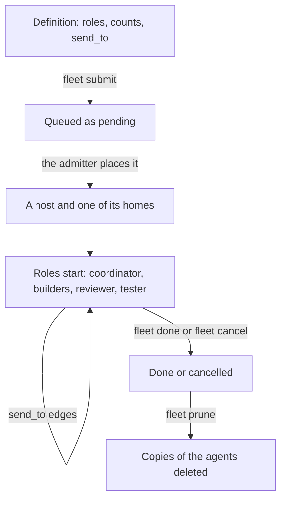

> Part of the Dockingbird customer docs. The index for agents is [llms.txt](../../llms.txt).

# Swarms

This guide for teams submits a swarm to the pool and changes it while it runs. A swarm is a team of agents the fleet scheduler starts from a definition. Most swarms start from the standard definition, sized and set with `--set` at the submit; a team that needs more roles writes its own. The model is on [the swarms and roles concept page](../concepts/swarms-and-roles.md), and every key of the definition is in [the definition reference](../reference/files/swarm-definition.md).

## Before you start

- The pool works. [The team fleet guide](team-fleet.md) and [the fleet scheduler guide](fleet-scheduler.md) are done, and `dockingbird fleet queue` lists your hosts.
- You are a member of the project, or you are the admin. `dockingbird org members` lists the membership, and a project's role queues its own swarms only.
- A home of the placement links a checkout of the repository. A `fleet submit` without one is refused with `refused: source: no home of the placement links a checkout of the repository`.
- You run the commands inside a checkout of the repository, so `.dockingbird/swarms/` is found. `git rev-parse --show-toplevel` prints its folder.

## A swarm's life



Text alternative. A definition names roles, their counts and who each may message. `fleet submit` queues it as pending. The admitter places it on a host and a home that fit, the roles start and message along their `send_to` edges, and `fleet done` or `fleet cancel` ends it. `fleet prune` then deletes the agents' kept copies.

## Start from the standard definition

`dockingbird init` installs the standard definition with the swarm skill, in `.agents/skills/dockingbird-swarm/library/standard/`: `swarm.toml` and the three briefs `build.md`, `review.md` and `test.md`. You submit it where it is, by its path from the top of the checkout, with no copy and no edit. It has three roles from the shipped role library, and the repository, the branch, every count, the tool and the plan are parameters.

| Role | Library role | Effort | Its count |
|---|---|---|---|
| `build` | `dockingbird/implementer` | `medium` | `implementers`, 1 to 12, default 2; the agent whose name ends in `build-N` takes task N of the plan |
| `review` | `dockingbird/reviewer` | `high` | `reviewers`, 1 to 4, default 1; each implementer gets a reviewer in turn |
| `test` | `dockingbird/tester` | `high` | `testers`, 1 to 3, default 1 |

| Parameter | Type | Default | What it sets |
|---|---|---|---|
| `source-repository` | `text`, at most 120 characters | none, so every submit gives it | `[source]` `repository`, the repository the agents work on, as `OWNER/NAME` |
| `source-branch` | `text`, at most 120 characters | none, so every submit gives it | `[source]` `branch`, the branch they work on |
| `implementers`, `reviewers`, `testers` | `int` | 2, 1, 1 | the three roles' counts |
| `harness` | `choice`: `claude` or `codex` | `claude` | the tool of all three roles |
| `plan` | `text`, at most 120 characters | the path the coordinator's first message names | the plan's path in the repository, which the three briefs name |

The file names no model and no fallback tool. Each role takes its model from the project file's `[roles.NAME]` or your organisation's store, as [Choose each role's model and effort](#choose-each-roles-model-and-effort) shows. A submit gives a role a fallback tool, as the end of this section shows.

1. Commit the plan on the branch the swarm will work on, and push the branch. `PATH` is the plan's path in the repository and `BRANCH` the branch.

   ```bash
   git add PATH
   git commit -m "Add the plan"
   git push -u origin BRANCH
   ```

   The step is done when `git status` prints `Your branch is up to date with 'origin/BRANCH'.` and `nothing to commit, working tree clean`.

2. Record a model for each kind of role on the swarm's tool, the `harness` parameter's: `implementer`, `reviewer` and `tester`. The submit refuses a role with no model at `role[N].model`.

   ```bash
   dockingbird org roles set implementer --harness claude --model MODEL --effort EFFORT
   ```

   The step is done when each row prints, such as `implementer with claude now runs MODEL at effort EFFORT.` `[roles.NAME]` in `.dockingbird/project.toml` serves instead.

3. Describe it from the top of the checkout. `fleet describe` prints every parameter and setting with its bounds and what it resolves to, and connects to nothing. It takes no `--set` and reads no values, so `source-repository` and `source-branch` print `"required": true`, with `binds` naming `source.repository` and `source.branch`. It reads no store either, so a model only the store gives shows as `required`.

   ```bash
   dockingbird fleet describe .agents/skills/dockingbird-swarm/library/standard
   ```

   The step is done when the JSON document prints.

4. Submit it from the top of the checkout, sized for the work: one implementer per task of the plan, up to 12; one reviewer per 3 to 4 implementers; one tester per 4 implementers. The file names no `key`, so `--key TEAM` names the swarm, and a repeat of that key answers the swarm queued first. Without `--key`, each submit queues a new swarm keyed `standard`, a dash and the UTC time.

   ```bash
   # a one-file fix: one implementer at high, one reviewer, one tester
   dockingbird fleet submit .agents/skills/dockingbird-swarm/library/standard --key TEAM \
     --set source-repository=OWNER/NAME --set source-branch=BRANCH --set plan=PATH \
     --set implementers=1 --set build.effort=high
   # a feature of five tasks: five implementers, two reviewers, two testers
   dockingbird fleet submit .agents/skills/dockingbird-swarm/library/standard --key TEAM \
     --set source-repository=OWNER/NAME --set source-branch=BRANCH --set plan=PATH \
     --set implementers=5 --set reviewers=2 --set testers=2
   ```

   `OWNER/NAME` is the repository, such as `example-org/example-app`. A submit without `source-repository` or `source-branch` is refused once for each, as `refused: params.source-branch: missing`. The same values fit one JSON document for `--values`, and a `--set` beside it beats the file for the same key.

   ```json
   {
     "params": {"source-repository": "OWNER/NAME", "source-branch": "BRANCH", "plan": "PATH", "implementers": 5, "reviewers": 2, "testers": 2},
     "roles": {"build": {"effort": "high"}, "review": {"effort": "xhigh"}}
   }
   ```

   The step is done when the swarm is queued.

   ```text
   {id} pending, position {position}
   ```

No role of the standard definition names a fallback tool. Three `--set` keys give a role one at the submit. Here the build role's agents move to Codex, at that model and effort, after a turn a safety system refused.

```bash
dockingbird fleet submit .agents/skills/dockingbird-swarm/library/standard --key TEAM \
  --set source-repository=OWNER/NAME --set source-branch=BRANCH --set plan=PATH \
  --set build.fallback.harness=codex --set build.fallback.model=MODEL --set build.fallback.effort=EFFORT
```

The role then follows the default rules: every transient failure, such as a rate limit or a server error, retries on the role's own tool, a refusal moves the agent, and every other failure is reported. A fallback harness that is the role's own tool is refused (`fallback-same`). A fallback model or effort left out comes from the project file's `[roles.NAME]` when its `harness` is the fallback's, else from your organisation's row for that tool. One that neither gives is refused at `role[N].fallback.model` or `role[N].fallback.effort` (`fallback-model`), so the harness alone, with no row for that tool, is refused at `role[N].fallback.model`. `fleet describe` takes no `--set`, so the submit is where a fallback is checked. [A role's fallback](../reference/files/swarm-definition.md#a-roles-fallback) lists its other keys.

The file's priority is `P2`; `fleet set ID --priority P1` changes it after the submit. Write a definition of your own, a copy of the standard one edited, only for what its parameters cannot express: more roles, such as a coordinator or readers, one brief per task, attachments, or a role's `skills`, `connections`, `send_to`, `subagents`, `harness_config` or `[role.fallback.on]`, which `--set` cannot set. The steps below write one.

## 1. Write a definition

A definition of your own lives at `.dockingbird/swarms/NAME/swarm.toml` in the checkout. It names the project, the priority, the source, the hosts to try in order and the roles. Each role's brief is a Markdown file under the definition's folder. The step is done when the file exists, and step 2 reads it back.

```toml
schema = 1
project = "example"
key = "example-feature-1"
priority = "P2"

[source]
repository = "example-org/example-app"
branch = "feature/example"

[placement]
hosts = ["lab", "cloud"]
home.lab = "/opt/dockingbird/homes/team-1"

[[role]]
name = "builder"
harness = "claude"
count = 2
min = 1
max = 4
brief = "briefs/builder.md"
send_to = ["reviewer"]

[[role]]
name = "reviewer"
harness = "claude"
count = 1
brief = "briefs/reviewer.md"
reviews = ["builder"]
```

A role may take its settings from a role library with `use = "NAME"`, as [the cookbook on role libraries](../../examples/swarm-from-a-role-library/README.md) shows. A definition may leave `[placement]` out. Its swarm then goes to every pool host that takes swarms, in pool rank order. A definition may also declare `[params]` and write `{{name}}` where a value goes, so one file serves many swarms. [The swarm parameters guide](swarm-parameters.md) shows how.

### Choose each role's model and effort

The example names no model and no effort, so the project decides them once for every swarm. Each role looks them up by name: the reviewer as `reviewer`, and the builder, which names the newer key `send_to`, as `builder` first, then as `implementer`. The project file's `[roles.NAME]` gives them for a role on that table's tool, else your organisation's store, `dockingbird org roles set NAME --harness H --model M --effort E`. A role's own `model` and `effort`, its library role's, or `--set` at submit override both, and a role that no source covers is refused at submit.

```toml
# .dockingbird/project.toml
[roles.implementer]
harness = "claude"
model = "MODEL"
effort = "medium"

[roles.reviewer]
harness = "claude"
model = "MODEL"
effort = "high"
```

Write a model word of the role's tool in place of `MODEL`. For a project that has set nothing yet, these are the recommended kinds of model and efforts. The highest-reasoning kind is the slowest and costs the most per turn, the fast kind the least. [Claude Code and Codex](../concepts/claude-code-and-codex.md#model-and-effort-per-role) names the model of each kind for each tool.

| Role | Kind of model | Effort |
|---|---|---|
| coordinator | mid | `xhigh` |
| implementer | mid | `medium` for a task the plan specifies in full; `high` for a fix in existing code, concurrency, or a task that leaves it a judgment |
| reviewer | highest reasoning | `high`; `xhigh` for concurrency, security, query generation or ranking, or a large diff |
| tester | fast | `high`; `xhigh` when it must judge a flaky or partial result |
| reader | fast | `medium`; `high` when its brief needs strict instruction following |
| hands | mid | `max` |

Raise an effort above the table's only for a gain you measured, since a higher effort costs more on every turn of the role's agents. [The definition reference](../reference/files/swarm-definition.md#where-a-roles-model-and-effort-come-from) gives the whole lookup order.

## 2. Describe it

Before you submit, ask the definition what it lets you set. `fleet describe` reads the checkout, connects to nothing and prints JSON: each parameter and each role's settable field, with its type, its bounds or words, and its default. Where a default comes from is named too (`file`, `params.<name>`, `library` or `project`). A model or effort the checkout does not give is marked `required`. It takes no values, so a parameter with no default is marked `required` too, with the places it `binds`, unless a role's value, `key` or `priority` names it: that one is refused `params.<name>: missing`, as at the submit. The defaults alone make a values document that `--values` accepts.

```bash
dockingbird fleet describe NAME
```

The step is done when the document prints. The first line below is its summary under `--json`.

```text
{definition}: its parameters and its roles' settings, each with its default
```

## 3. Submit it

`fleet submit` takes the definition by name from anywhere in the checkout, or by a folder or a file. It checks every rule before it stores anything. It prints each refusal as `refused: <field>: <rule>` in a fixed order, then ends 1. A definition with a `key` answers the swarm queued first when you submit the same key again. Without a `key`, each submit queues a new swarm named for the definition, a dash and the UTC time as `YYYYMMDDhhmmss`, unless `--key KEY` names one.

```bash
dockingbird fleet submit NAME
dockingbird fleet submit NAME --set grader.count=6 --set grader.helper.max=4
dockingbird fleet submit NAME --values values.json
```

`--set KEY=VALUE` is repeatable. A key is a parameter the definition declares, a role's setting, a subagent's or a key of a role's fallback. `--values FILE` is a JSON document of the shape `{"params": {...}, "roles": {"ROLE": {...}}}`. A `--set` beats the file for the same key. A submit may set a role's `count`, `min`, `max`, `model`, `effort`, `compact_at` and `session_hours`, a subagent's `model`, `effort` and `max`, and a role's fallback `harness`, `model`, `effort` and `placement`, as in `--set builder.fallback.harness=codex`. `fleet queue` and `fleet why` show the values a swarm was given. [The definition reference](../reference/files/swarm-definition.md#parameters) has the parameters' types, the built-ins such as `{{branch}}`, and the rule each refusal names. [The swarm parameters guide](swarm-parameters.md) walks through three submits of one definition and the rules for each value.

The step is done when the swarm is queued.

```text
{id} pending, position {position}
```

Every agent the fleet starts gets `--compact-at 500000` and `--session-hours 48` unless its role names its own. The shipped roles name their compact point: `300k` for `coordinator` and `hands`, `500k` for `implementer`, `reviewer`, `tester` and `reader`. A role's `compact_at`, or `--set ROLE.compact_at=POINT` at the submit, overrides it. Each implementer is given a reviewer and a tester, round-robin, and every brief names them. Read the queue with `fleet queue`, and `fleet why ID` names what holds a swarm.

## 4. Change a running swarm

These commands change a swarm that runs. Each stops an agent only after its running turn, never during it, and each answers with the state and the agents still working.

```bash
dockingbird fleet add ID reviewer --count 2 --reason "review backlog"
dockingbird fleet retire ID build-3 --reason "done with its task"
dockingbird fleet replace ID build-1
dockingbird fleet replace ID build-1 --fresh
dockingbird fleet assign ID build-2 --reviewer review-2 --tester test-1
```

`add` adds agents of a role up to its `max`, under the role's next names. Each starts once its host has room and is briefed with the roster, and the others are told the new one. `retire` ends one agent and gives its share back. It is refused when the swarm is not running, the agent is unknown, or the role is at its `min`. The agent's worker also refuses while the agent is working, asking or waiting. `replace` stops an agent and starts it again by its name with its conversation kept, and `--fresh` starts a new agent of its role under the next name. `assign` names the reviewer and tester of one agent, and an option you leave out keeps its old value.

An agent whose last turn failed, or whose process crashed while its container runs, takes no turn. `fleet replace ID NAME` is its recovery. An agent that hands its parent back a `status: done` message is retired on its own word, and `status: partial` or `status: blocked` retires nothing.

When a review request or an approved commit waits five minutes for a reviewer or tester, the fleet hands that implementer to an idle agent of the role or adds one within the role's `max`. It never stops, restarts or moves an agent that is working.

```text
{id} running: added {names}; each starts once its host has room
{id} running: {name} retires once its running turn ends
{id} running: {name} starts again once its running turn ends
{id}: {name} is reviewed by {reviewer} and tested by {tester};
its host tells {name} and the agents it moved from and to at its next tick.
```

## 5. Prune after a merge

When the swarm is done or cancelled and its branch is merged, `prune` deletes its agents' kept copies. `SHA` is the tested head you proved merged in your own checkout, for example with `git merge-base --is-ancestor SHA origin/main`. The scheduler never checks it. A commit an agent made and never published goes with its copy.

```bash
dockingbird fleet prune ID --merged SHA
```

```text
Queued the prune of {id} as job {job_id}.
```

## Spread a swarm over hosts

A swarm whose definition says `spread = true` under `[placement]` may run on more than one host of its list. A role may name `hosts = [...]`, the hosts of the list its agents may take, in order. The roles that publish commits, each role that reviews and each role another reviews or tests, share one host. `fleet where` names where each agent runs.

```bash
dockingbird fleet where ID
```

The step is done when the swarm's line prints, then one line for each agent.

```text
{id} {state}: {hosts}
{name} {role} {step} on {host} in {home}
{name} {role} {step} not placed
```

## This home's record of swarms

A home keeps a record of the swarm each of its agents belongs to, its role there, and who reviews and tests its work. The `swarm` commands edit that record and nothing else. No agent starts, stops or hears about the edit. They suit agents you started by hand with `start --swarm NAME`. The fleet edits its own swarms through `fleet`, and `swarm` refuses them. The five lines under the commands answer them in order.

```bash
dockingbird swarm list
dockingbird swarm add review-1 --swarm hi --role reviewer
dockingbird swarm role review-1 --role tester
dockingbird swarm assign build-1 --reviewer review-1
dockingbird swarm remove review-1
```

```text
{swarm}: {agents} ({source})
review-1 joined hi as reviewer.
review-1 is now tester in hi.
build-1 in hi: reviewer review-1, tester {tester}.
review-1 left hi; it keeps running: dockingbird stop review-1 stops it.
```

## When it fails

### Submitting

These ids come from `fleet describe` and `fleet submit`. Each line says what the id means and what to do.

- [`FLEET_REFUSED`](../troubleshooting.md#fleet_refused) lists a field of the definition and the rule it breaks. Fix the field and submit again.
- [`FLEET_NAME_UNKNOWN`](../troubleshooting.md#fleet_name_unknown) means no definition of that name sits under `.dockingbird/swarms/` in this checkout, or you are not in a checkout.
- [`FLEET_PROJECT_MISMATCH`](../troubleshooting.md#fleet_project_mismatch) means the checkout, the definition and `--project` name different projects. Nothing was sent.
- [`FLEET_FILE_UNREADABLE`](../troubleshooting.md#fleet_file_unreadable) means the definition or the values file cannot be read as a file.
- [`FLEET_NOT_A_MEMBER`](../troubleshooting.md#fleet_not_a_member) means you are not a member of the project. An admin runs `org members add`.
- [`FLEET_NO_CONNECTION`](../troubleshooting.md#fleet_no_connection) holds a swarm because its home lacks a connection a role lists. Connect it there, then run `fleet release ID`.
- [`FLEET_WHY_STATE`](../troubleshooting.md#fleet_why_state) prints `{id} is held: skills_refused` when a start's clone lacks a path a role's `skills` names. Push the fix, then run `fleet release ID`, as [the skills guide](skills.md) shows.
- [`FLEET_WHY_SPREAD`](../troubleshooting.md#fleet_why_spread) names, for a waiting swarm that may spread, the first group of its roles that fits on no host and what keeps it off each host.

### Changing a running swarm

These ids come from the commands of steps 4 and 5 and from the home's own `swarm` record.

- [`FLEET_RETIRE_REFUSED`](../troubleshooting.md#fleet_retire_refused) covers `retire` and `replace`: the swarm is not running, the agent is unknown, or the role sits at its minimum.
- [`FLEET_ASSIGN_REFUSED`](../troubleshooting.md#fleet_assign_refused) means the swarm is not running, or the reviewer or tester is no live agent of it.
- [`FLEET_PRUNE_REFUSED`](../troubleshooting.md#fleet_prune_refused) means `--merged` was not a full commit id, or the workload is not a finished swarm.
- [`SWARM_ENGINE_OWNED`](../troubleshooting.md#swarm_engine_owned) means the fleet runs that swarm. Use `fleet retire`, `replace`, `assign` or `add` on it.
- [`SWARM_NOT_A_MEMBER`](../troubleshooting.md#swarm_not_a_member) means the agent is in no swarm yet. Put it in one with `swarm add`.
- [`SWARM_ASSIGNEE_IS_SELF`](../troubleshooting.md#swarm_assignee_is_self) says an agent cannot review or test its own work. Name another member.
