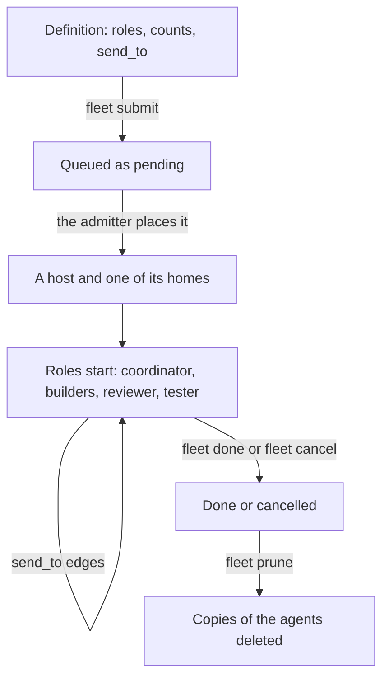

> Part of the Dockingbird customer docs. The index for agents is [llms.txt](../../llms.txt).

# Swarms

This guide for teams writes a swarm definition, submits it to the pool and changes the swarm while it runs. A swarm is a team of agents the fleet scheduler starts from a definition. The model is on [the swarms and roles concept page](../concepts/swarms-and-roles.md), and every key of the definition is in [the definition reference](../reference/files/swarm-definition.md).

## Before you start

- The pool works. [The team fleet guide](team-fleet.md) and [the fleet scheduler guide](fleet-scheduler.md) are done, and `dockingbird fleet queue` lists your hosts.
- You are a member of the project, or you are the admin. `dockingbird org members` lists the membership, and a project's role queues its own swarms only.
- A home of the placement links a checkout of the repository. A `fleet submit` without one is refused with `refused: source: no home of the placement links a checkout of the repository`.
- You run the commands inside a checkout of the repository, so `.dockingbird/swarms/` is found. `git rev-parse --show-toplevel` prints its folder.

## A swarm's life



Text alternative. A definition names roles, their counts and who each may message. `fleet submit` queues it as pending. The admitter places it on a host and a home that fit, the roles start and message along their `send_to` edges, and `fleet done` or `fleet cancel` ends it. `fleet prune` then deletes the agents' kept copies.

## 1. Write a definition

Keep the definition at `.dockingbird/swarms/NAME/swarm.toml` in the checkout. It names the project, the priority, the source, the hosts to try in order and the roles. Each role's brief is a Markdown file under the definition's folder. The step is done when the file exists, and step 2 reads it back.

```toml
schema = 1
project = "example"
key = "example-feature-1"
priority = "P2"

[source]
repository = "example-org/example-app"
branch = "feature/example"

[placement]
hosts = ["lab", "cloud"]
home.lab = "/opt/dockingbird/homes/team-1"

[[role]]
name = "builder"
harness = "claude"
model = "opus"
effort = "high"
count = 2
min = 1
max = 4
brief = "briefs/builder.md"
send_to = ["reviewer"]

[[role]]
name = "reviewer"
harness = "claude"
model = "sonnet"
effort = "high"
count = 1
brief = "briefs/reviewer.md"
reviews = ["builder"]
```

A role may take its settings from a role library with `use = "NAME"`, as [the cookbook on role libraries](../../examples/swarm-from-a-role-library/README.md) shows. A definition may leave `[placement]` out. Its swarm then goes to every pool host that takes swarms, in pool rank order.

## 2. Describe it

Before you submit, ask the definition what it lets you set. `fleet describe` reads the checkout, connects to nothing and prints JSON: each parameter and each role's settable field, with its type, its bounds or words, and its default. Where a default comes from is named too (`file`, `params.<name>`, `library` or `project`). A model or effort the checkout does not give is marked `required`. The defaults alone make a values document that `--values` accepts.

```bash
dockingbird fleet describe NAME
```

The step is done when the document prints. The first line below is its summary under `--json`.

```text
{definition}: its parameters and its roles' settings, each with its default
```

## 3. Submit it

`fleet submit` takes the definition by name from anywhere in the checkout, or by a folder or a file. It checks every rule before it stores anything. It prints each refusal as `refused: <field>: <rule>` in a fixed order, then ends 1. A definition with a `key` answers the swarm queued first when you submit the same key again. Without a `key`, each submit queues a new swarm named for the definition, a dash and the UTC time as `YYYYMMDDhhmmss`, unless `--key KEY` names one.

```bash
dockingbird fleet submit NAME
dockingbird fleet submit NAME --set grader.count=6 --set grader.helper.max=4
dockingbird fleet submit NAME --values values.json
```

`--set KEY=VALUE` is repeatable. A key is a parameter the definition declares, a role's setting or a subagent's. `--values FILE` is a JSON document of the shape `{"params": {...}, "roles": {"ROLE": {...}}}`. A `--set` beats the file for the same key. A submit may set a role's `count`, `min`, `max`, `model`, `effort`, `compact_at` and `session_hours`, and a subagent's `model`, `effort` and `max`.

The step is done when the swarm is queued.

```text
{id} pending, position {position}
```

Every agent the fleet starts gets `--compact-at 500000` and `--session-hours 48` unless its role names its own. Each implementer is given a reviewer and a tester, round-robin, and every brief names them. Read the queue with `fleet queue`, and `fleet why ID` names what holds a swarm.

## 4. Change a running swarm

These commands change a swarm that runs. Each stops an agent only after its running turn, never during it, and each answers with the state and the agents still working.

```bash
dockingbird fleet add ID reviewer --count 2 --reason "review backlog"
dockingbird fleet retire ID build-3 --reason "done with its task"
dockingbird fleet replace ID build-1
dockingbird fleet replace ID build-1 --fresh
dockingbird fleet assign ID build-2 --reviewer review-2 --tester test-1
```

`add` adds agents of a role up to its `max`, under the role's next names. Each starts once its host has room and is briefed with the roster, and the others are told the new one. `retire` ends one agent and gives its share back. It is refused when the swarm is not running, the agent is unknown, or the role is at its `min`. The agent's worker also refuses while the agent is working, asking or waiting. `replace` stops an agent and starts it again by its name with its conversation kept, and `--fresh` starts a new agent of its role under the next name. `assign` names the reviewer and tester of one agent, and an option you leave out keeps its old value.

An agent whose last turn failed, or whose process crashed while its container runs, takes no turn. `fleet replace ID NAME` is its recovery. An agent that hands its parent back a `status: done` message is retired on its own word, and `status: partial` or `status: blocked` retires nothing.

When a review request or an approved commit waits five minutes for a reviewer or tester, the fleet hands that implementer to an idle agent of the role or adds one within the role's `max`. It never stops, restarts or moves an agent that is working.

```text
{id} running: added {names}; each starts once its host has room
{id} running: {name} retires once its running turn ends
{id} running: {name} starts again once its running turn ends
{id}: {name} is reviewed by {reviewer} and tested by {tester};
its host tells {name} and the agents it moved from and to at its next tick.
```

## 5. Prune after a merge

When the swarm is done or cancelled and its branch is merged, `prune` deletes its agents' kept copies. `SHA` is the tested head you proved merged in your own checkout, for example with `git merge-base --is-ancestor SHA origin/main`. The scheduler never checks it. A commit an agent made and never published goes with its copy.

```bash
dockingbird fleet prune ID --merged SHA
```

```text
Queued the prune of {id} as job {job_id}.
```

## This home's record of swarms

A home keeps a record of the swarm each of its agents belongs to, its role there, and who reviews and tests its work. The `swarm` commands edit that record and nothing else. No agent starts, stops or hears about the edit. They suit agents you started by hand with `start --swarm NAME`. The fleet edits its own swarms through `fleet`, and `swarm` refuses them. The five lines under the commands answer them in order.

```bash
dockingbird swarm list
dockingbird swarm add review-1 --swarm hi --role reviewer
dockingbird swarm role review-1 --role tester
dockingbird swarm assign build-1 --reviewer review-1
dockingbird swarm remove review-1
```

```text
{swarm}: {agents} ({source})
review-1 joined hi as reviewer.
review-1 is now tester in hi.
build-1 in hi: reviewer review-1, tester {tester}.
review-1 left hi; it keeps running: dockingbird stop review-1 stops it.
```

## When it fails

### Submitting

These ids come from `fleet describe` and `fleet submit`. Each line says what the id means and what to do.

- [`FLEET_REFUSED`](../troubleshooting.md#fleet_refused) lists a field of the definition and the rule it breaks. Fix the field and submit again.
- [`FLEET_NAME_UNKNOWN`](../troubleshooting.md#fleet_name_unknown) means no definition of that name sits under `.dockingbird/swarms/` in this checkout, or you are not in a checkout.
- [`FLEET_PROJECT_MISMATCH`](../troubleshooting.md#fleet_project_mismatch) means the checkout, the definition and `--project` name different projects. Nothing was sent.
- [`FLEET_FILE_UNREADABLE`](../troubleshooting.md#fleet_file_unreadable) means the definition or the values file cannot be read as a file.
- [`FLEET_NOT_A_MEMBER`](../troubleshooting.md#fleet_not_a_member) means you are not a member of the project. An admin runs `org members add`.
- [`FLEET_NO_CONNECTION`](../troubleshooting.md#fleet_no_connection) holds a swarm because its home lacks a connection a role lists. Connect it there, then run `fleet release ID`.
- [`FLEET_WHY_STATE`](../troubleshooting.md#fleet_why_state) prints `{id} is held: skills_refused` when a start's clone lacks a path a role's `skills` names. Push the fix, then run `fleet release ID`, as [the skills guide](skills.md) shows.

### Changing a running swarm

These ids come from the commands of steps 4 and 5 and from the home's own `swarm` record.

- [`FLEET_RETIRE_REFUSED`](../troubleshooting.md#fleet_retire_refused) covers `retire` and `replace`: the swarm is not running, the agent is unknown, or the role sits at its minimum.
- [`FLEET_ASSIGN_REFUSED`](../troubleshooting.md#fleet_assign_refused) means the swarm is not running, or the reviewer or tester is no live agent of it.
- [`FLEET_PRUNE_REFUSED`](../troubleshooting.md#fleet_prune_refused) means `--merged` was not a full commit id, or the workload is not a finished swarm.
- [`SWARM_ENGINE_OWNED`](../troubleshooting.md#swarm_engine_owned) means the fleet runs that swarm. Use `fleet retire`, `replace`, `assign` or `add` on it.
- [`SWARM_NOT_A_MEMBER`](../troubleshooting.md#swarm_not_a_member) means the agent is in no swarm yet. Put it in one with `swarm add`.
- [`SWARM_ASSIGNEE_IS_SELF`](../troubleshooting.md#swarm_assignee_is_self) says an agent cannot review or test its own work. Name another member.
